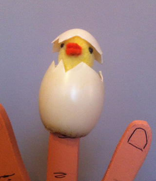

Helaas, deze voorstelling is inmiddels verkocht!

Interactieve vertelvoorstelling voor peuters en kleuters, met veel liedjes, begeleid op de gitaar.
 We zien hoe een eendenkuikentje geboren worden en beleven mee hoe hij de sloot ontdekt. Het wordt een beetje te spannend voor hem als er een reiger over komt vliegen. Maar gelukkig is zijn mama in de buurt...

Leeftijd: 3 t/m 6 jaar
 geschikt voor mensen met een verstandelijke beperking
 geschikt als prikkelvriendelijk aanbod*
 duur: 35 tot 45 minuten
 opbouwen (met licht en geluid): 1,5 uur, afbreken 1 uur
 speelvlak: 3 x 3 meter
 oplopende zitplaatsen (zeker bij meer dan 40 kinderen!)
 niet te grote ruimte waar geen andere activiteit plaatsvindt, ook geen open bar
 €425,-, exclusief BTW en reiskosten (€0.40/km)
 In de provincies Groningen, Friesland en Drenthe is de prijs €375,- ex.
 2e en volgende voorstellingen (op dezelfde plek, op dezelfde dag) €175,-
 Ideale aantal kleuters: 40 (met eventueel 40 ouders).

Kortere (en dus goedkopere) versies van deze voorstelling kunnen in overleg geboekt worden.

Beetje donker fragment van de voorstelling : 
<iframe width="320" height="315" src="https://www.youtube.com/embed/Voyhghm30TA" frameborder="0" allow="accelerometer; autoplay; encrypted-media; gyroscope; picture-in-picture" allowfullscreen></iframe>

Klik [hier](/eendenmarionet) om zelf een eenden-marionet te maken.

Klik [hier](/kuiken) om zelf het pop-up-kuiken te maken, dat in de voorstelling wordt gebruikt.

