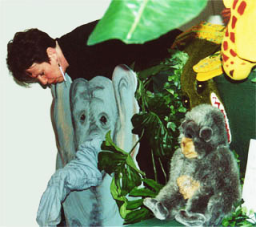

 Ontwerp affiche: Boris Reuderink

Deze voorstelling wordt niet meer gespeeld.

Op een dag staat er plotseling een potje in het oerwoud. Van wie zou dat potje zijn?
 Er ligt een briefje bij: "Alleen voor de allerliefste billetjes".
 Alle dieren proberen er op te zitten, maar alleen de billetjes van een klein jongetje passen.

Aan het eind geven de kinderen de olifant een "slurfje"; de olifant kan dan eventueel iets uitdelen wat door u aangeschaft is, bijv. bananensnoepjes of echte bananen.

 Voor patroon van deze olifant klik [hier](/mouwslurfolifant).

<iframe width="320" height="315" src="https://www.youtube.com/embed/WfDUOM7QbZs" frameborder="0" allowfullscreen></iframe>

