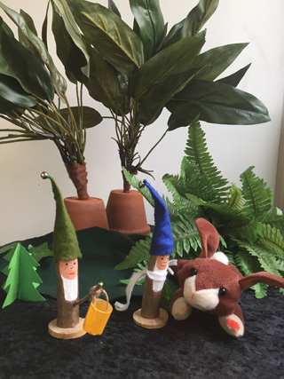
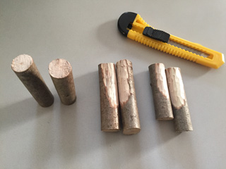
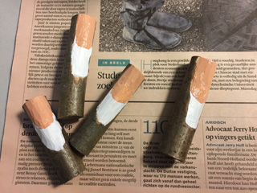
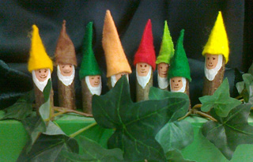

Zaag een flinke tak in stukken, het zaagvlak zo haaks mogelijk op de tak i.v.m. balans. Schuur de zaagvlakken.
 Mijn kabouters waren ongeveer 8 cm lang, de omtrek was 7 cm, doornee 2 cm.
 Als ze niet goed blijven staan, kun je er een schijfje van een dikkere tak onder plakken.

 Schil de bast van 1 kant van de tak af om gezicht/baard te maken (mesje altijd van je af gebruiken!)

 Schilder de baardjes en gezichtjes. Hou er rekening mee, dat het mutsje een plakrand heeft. Maak het gezicht dus wat langer.

Knip het mutsje uit vilt volgens onderstaand patroon (klik op het plaatje voor een A4-formaat). Dit mutsje is passend voor mijn maat kabouters. Is jouw tak dikker of dunner, meet dan de omtrek en maak het patroon in verhouding groter of kleiner.

Speel met 2 kabouters onderstaand versje voor Kerst.
 Het is een vrije bewerking van "Moontje is verdwaald" uit "De vier kaboutertjes in de herfst" van Marianne Busser/Ron Schröder.
[De 2 kaboutertjes halen een kerstboom.pdf](<https://peterselie.nl/files/De 2 kaboutertjes halen een kerstboom.pdf> "Download: De 2 kaboutertjes halen een kerstboom.pdf (30 KB)")

Hieronder het patroon voor de kerstboom. Klik erop voor een A4-formaat.

