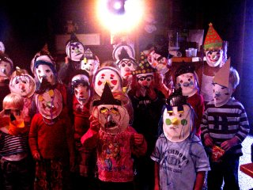
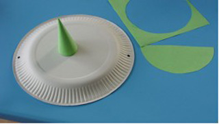
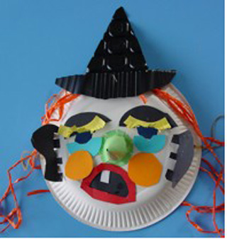

Wat heb je nodig?
 papieren bord
 helft van een papieren cirkel van ongeveer 14 cm doorsnee
 papier- en kartonresten
 2 elastiekjes, lijm, plakband
 schaar, nietmachine, ponsapparaat

Hoe maak je het masker?
 Doe plakband over de plekken waar je gaatjes wilt maken voor de elastiekjes (voor over je oren) en pons daarna de gaatjes.
 Maak van de halve cirkel een kegel en zet vast met plakband.
 Knip aan de onderkant van de kegel flapjes en plak de kegel als neus op het papieren bord.

 Laat iemand anders voorzichtig rondjes tekenen op de plek waar jouw ogen zitten, als je het masker voor je gezicht houdt. Knip de rondjes uit. Versier het gezicht met papier. Plak er haar op van raffia, wol of papieren stroken.

 Knip eventueel een hoed uit en niet deze op het masker.
 Doe de elastiekjes door de gaatjes en zet het masker op. Boeh!!
 Je kunt er ook een stok achter plakken, dan heb je een stokpop.
