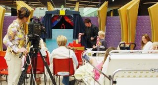
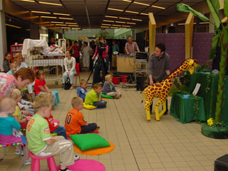

 Affiche van de actie "bosje peterselie".

Als u eens iets anders dan een bosje bloemen wilt geven na afloop van de  voorstelling van Poppentheater Peterselie, kunt u een gift aan de actie Bosje Peterselie overwegen.
 Door deze actie te steunen maakt u het mogelijk dat Peterselie gratis of tegen sterk gereduceerd tarief speelt in een ziekenhuis, of bij een chronisch ziek kind, of bij een klein groepje kinderen, dat wat meer individuele aandacht nodig heeft om van een voorstelling te kunnen genieten.

 Dankzij de bijdragen van de Culturele Raad Smilde, bibliotheek Lelystad, peuterspeelzaal de Woelige Hoek in Nijkerk en vele andere gulle gevers kon Poppentheater Peterselie een voorstelling geven op de afdeling Kinderoncologie van het AZ Groningen.

 Op 7 juni 2006 is er weer een voorstelling gegeven in het AZG dank zij een aantal anonieme gulle gevers aan de aktie Bosje Peterselie. Ook het Fonds NRC-lezers leverde een bijdrage. Alle gevers bedankt!

 foto: Henkjan Ruijfrok
 9 mei 2007,  jaarlijks optreden van Poppentheater Peterselie voor UMCG Kinderteevee (in het vroegere Academisch Ziekenhuis) in Groningen, o.a. mogelijk gemaakt door het Fonds NRC Handelsbladlezers, de actie Bosje Peterselie, en peuterspeelzaal Hummelhof in Engelbert.

 Op 13 februari 2008 gaf Peterselie de voorstelling "Muis zoekt huis" voor UMCG KinderTeeVee, dankzij  een bijdrage van Fonds NRC Handelsblad Lezers, peuterspeelzaal Hummelhof uit Engelbert, Bibliotheek Zuidlaren, Dagcentrum de Frans en diverse andere sponsoren.

 Op 23 april 2009 de jaarlijkse voorstelling ("Pien en de Wolf") voor UMCG KinderTeeVee dank zij de regelmatige steun van o.a. Bibliotheek Hoorn en een aantal anonieme gevers.

 Op 24 juni 2013 speelde Poppentheater Peterselie voor de Stichting Make-a-wish (vroeger: Doe-een-wens) een voorstelling voor een gehandicapt meisje, dat net een hersenoperatie achter de rug had, en haar zusje. Deze voorstelling kon  dank zij uw giften gegeven worden. In deze financieel barre tijden zijn bijdragen voor dit soort projecten meer dan welkom!
