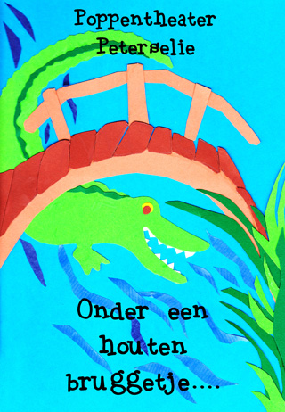

Helaas: Dit verhaal wordt niet meer gespeeld!

Krokodil denkt dat plagen leuk is, maar natuurlijk wil na een tijdje niemand meer met hem spelen. Dan komt er een andere krokodil en ze gaan nu samen plagen. Maar dan doet Nijlpaard zijn grote bek open en laat ze beloven dat ze de dieren met rust zullen laten. Ze bijten nu alleen nog maar elkaar: in elkaars billen, in elkaars poten en in elkaars bek. Dan bijten ze zachter en zachter en zachter.....tot ze aan het knuffelen zijn. En dat bevalt toch een stuk beter!

Het liedje dat tijdens de voorstelling wordt gezongen staat
[hier](http://www.peterselie.nl/liedjesbruggetje).

 Lekker meedoen met "De kikkertjes"
