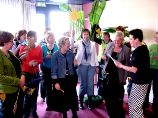

"Peterselie" Puppet Theatre offers workshops and courses on aspects of the puppet theatre with emphasis on daring to play with the puppets made. 
If desired a 2-4 hour workshop can be set up or a course with in-depth treatment of the subjects.

**FOR ADULTS**

**[Picture + Puppet = Language](/prentpoptaal)** 
A 2 or 3-hour workshop on making a picture-book (and hence reading) even more attractive through a puppet-show. 
A theoretical introduction on the various "intermediaries" to be used for this is followed by a commentary on the "exhibition", with many examples. 
In conclusion each participant will make a simple puppet, after which the puppets will be used in a short story, to be performed by all the participants together. 
**[Easy-to-make puppets](/makkelijkepoppen)** 
The student will learn how to make quick-to-finish puppets and especially how to use them in  a variety of games. 
**["Operated" cuddles](/opererenberen)** 
How to transform a cuddle into a theatre puppet and play with it? 
**[Playing with sub-personalities](/heleboelpoppen)** 
Our personality is made up of various "sub-personalities", a number of which we use in all kinds of situations every day; these are our primary sub-personalities. These sub-personalities together we often see as our "self". 
We also have a number of sub-personalities we are not aware of. For example: the "Mother" sub-personality is often not apparent until after the birth of the first child. 
Suppressed personalities come under yet another category. These are patterns frowned upon by society or parents, such as Aggression (especially for girls). Though suppressed, we cannot really get rid of these energy patterns: at a sub-conscious level they will continue to bother us in a distorted way. 
By facing up to this and accepting them we can use the energies of these sub-personalities, thus becoming more complete persons again. We can explore them by using puppets. 
This workshop is meant to be a playful eye-opener, getting us acquainted with the suppressed aspects of our personality. 
We will make simple puppets and masks, both of our "light" and our "dark" side, playing some pleasant games with them. 
Also available as a six-day course. Then we use fairy tales and six different puppet techniques.

**FOR CHILDREN**

**[Join-in performances with workshops](/meespeelvoorstellingen)** 
**[Follow-up workshops](/workshops)**
