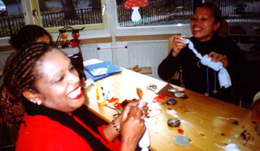
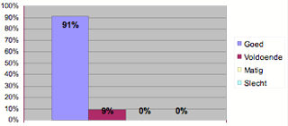
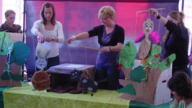

 
Workshop Kinderopvang Groningen

Als cultureel werker en later als poppenspeler heeft Marjanne Peters van Poppentheater Peterselie veel ervaring opgedaan met het organiseren en begeleiden van creatieve activiteiten voor groepen kinderen en volwassenen. 
Het is een passie om kennis door te geven en creatieve ontplooiing bij deelnemers te stimuleren, nu richt zich dat voornamelijk op het gebied van poppenspel.

Marjanne Peters in een interview met Selma de Witte: 
"Eigenlijk zijn de meeste workshops die ik geef  erop gericht om te bewijzen hoe eenvoudig theaterpoppen kunnen zijn en dat iedereen dus ook poppen kan maken. Het gaat daarbij nooit uitsluitend om de techniek van het poppen maken; voorop staat dat  een pop moet kunnen doen wat wij nodig vinden en niet meer dan dat.  En de pop moet het liefst ook nog een beetje snel klaar zijn. 
Verder ligt de nadruk op het (plezier in het) spelen; het is een kwestie van durven en in de juiste sfeer durft iedereen. 
Het allerbelangrijkste is: Wat er gebeurt met mensen als ze bezig zijn met poppenspel? 
Een pop biedt zowel bij de speler als de kijker gelegenheid om er gevoelens op te projecteren en op afstand naar die gevoelens te kijken, zodat er een leermoment gecreëerd kan worden of eventueel verwerking van emoties kan optreden. 
De pop is per definitie door zijn starre uiterlijk een een-dimensionaal karakter, niet genuanceerd en geeft daardoor de mogelijkheid om de extremen van (eigen) gedrag te onderzoeken. 
Voor mij is poppenspel nooit alleen maar entertainment, en dat wil ik ook overbrengen in een workshop. Er moet na afloop van een voorstelling iets gebeurd zijn. Mensen moeten hoopvol weggaan met het gevoel dat er een uitweg is uit situaties die als ingewikkeld of moeilijk beleefd worden."

In overleg kan een workshop worden samengesteld van een uur tot meerdere dagdelen (eventueel met een uitvoering aan het eind), of een cursus waarbij dieper op de onderwerpen wordt ingegaan, en waarbij aan het eind een certificaat wordt verstrekt.

De prijs van een workshop is in de provincies Groningen, Friesland, Drenthe vanaf €175, inclusief materiaal en exclusief BTW en reiskosten (vanuit Westdorp à 0.40E/km). 

Een workshop wordt vanuit een instelling of groepje mensen georganiseerd en kan gegeven worden op de eigen locatie. 
Peterselie organiseert zelf geen workshops waar individueel op ingeschreven kan worden.

Mogelijkheden voor de workshops poppenspel zijn:

**voor volwassenen:** 
\- NIEUW: [Poppenspel in educatie en therapie/coaching](/coachingtherapie) 
\- [Prent + Pop = Taal (Voorlezen met poppen)](/prentpoptaal) 
\- [Verteltafel en tafelpoppen](/tafelpoppen) 
\- [Het opereren van beren](/opererenberen) (knuffels bespeelbaar maken) 
\- [Een kiekeboe-pop maken (pop-up)](/kiekeboe) 
\- [Een voorstelling in 1 dag!](/voorstellingmaken) 
\- [Gemakkelijk te maken poppen](/makkelijkepoppen), cursus 
\- [Workshop Gelukspop](/workshopgelukspop)

\- [Meedoe-voorstellingen (inclusief workshop)](/meespeelvoorstellingen), o.a.: 
-- [Een dame en tien poezen&#x2028;](/poezen) 
-- [Tien domme heksjes&#x2028; (archief)](/heksjes) 
-- [Het grote vogelochtendkoor (archief)](/vogelkoor) 
-- [De Prinses op de Erwt](/erwt)

**voor kinderen:** 
\- [Meedoe-voorstellingen](/meespeelvoorstellingen) 
\- [Workshops na een voorstelling](/workshops) 
\- [De Poppenfabriek](/poppenfabriek) 
\- [Workshop Gelukspop](/workshopgelukspop)

 
Evaluatie van de workshop Prent + Pop door Peterselie op de Boekenpretstudiedag 3 nov 06

Studiedag 7 april 06 
.....Marjanne Peters van de workshop ‘poppenspel’ maakte de drempel voor creatief werken met kinderen voor mij opnieuw lager, door aan te geven dat je zelf niet creatief hoeft te zijn om creativiteit bij kinderen te kunnen ontwikkelen. Essentieel is om het kind vrijheid en jouw vertrouwen te geven. 
Door Marjannes enthousiaste manier van vertellen over haar zoektocht naar een poppenspel-vorm die het beste bij haar zelf past, en door het laten zien van veel eenvoudig te maken poppen, groeide bij mij het zelfvertrouwen dat ik zoiets toch ook best meer zou kunnen doen in de klas. 
Marianne Visser 
Leerkracht pcbs ‘De Hoeksteen’ te Barendrecht 

 
Oefenen... 
 
....en uitvoering bij een kinderdagverblijf als afsluiting van een workshopdag. 
Twee korte filmpjes van deze workshop: 
[MOV03758.MPG](https://peterselie.nl/files/MOV03758.MPG "Download: MOV03758.MPG (1.31 MB)") 
[MOV03759.MPG](https://peterselie.nl/files/MOV03759.MPG "Download: MOV03759.MPG (1.31 MB)")
