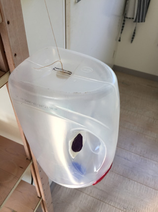
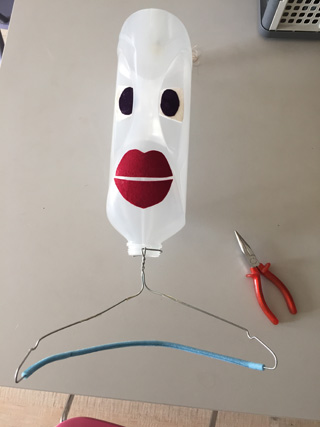
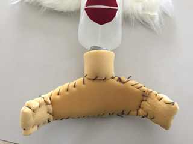

Voor het hoofd gebruiken we een grote plastic fles van wasmiddel, met een handvat.

De plek waar de schroefdop zit wordt de nek.
 Gebruik papier of vilt of ander teken-/knutselmateriaal om er een gezicht van te maken, met het handvat als neus.

Voordat je het haar aanbrengt, moet er eerst een touwtje op de kruin worden bevestigd. Maak hiervoor een snee in de bodem van de fles, net zo groot, als de knoop die je hiervoor gaat gebruiken. Maak een stuk touw aan de knoop vast, duw de knoop door de snee naar binnen en trek hem aan. Maak aan het einde van dit touw een houtje vast als handvat. Maak het touw zo lang, dat het hoofd van de marionet ongeveer op gelijke hoogte is met jouw hoofd, als je je gestrekte arm wat schuin boven je hoofd houdt (het wordt gauw zwaar!)
 Plak het haar op de schedel, om de bevestigingsplaats van het touw heen.

Het kan zonder, maar om wat meer schoudervulling te krijgen, kun je een kleerhanger in of om de nekopening vastmaken.

Schuimrubber rondom de kleerhanger naaien maakt het allemaal wat minder schonkig.

Je kunt het hoofd bevestigen in het midden van  een grote soepele lap, maar in dit geval is er een jurk met lange mouwen aan de nek vast gemaakt.
 In de openingen van de mouwen zijn opgevulde handschoenen genaaid, met de duim naar boven.
 De uiteinden van het touw waarmee de handen bewegen, zijn in de "muis" van de duim vastgenaaid.

