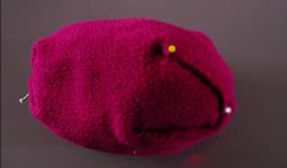
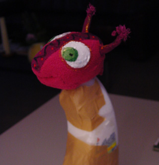
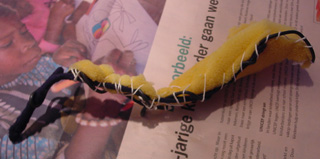
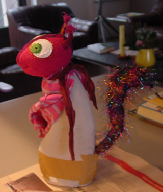

Alle poppen uit de voorstelling: "Waar is mijn mama?"  van Poppentheater Peterselie (inmiddels verkocht aan een beginnend poppentheater) zijn zelf-ontworpen tafelpoppen, gemaakt van plastic flessen, containers, yogurtbekers en plantenpotten.
 Hoe worden ze gemaakt:

 Zoek een fles die de gewenste vorm heeft. Haal ongewenste delen er met een afbreekmesje (pas op!) of figuurzaag af.
 Om de pop stevig te laten staan, kan er een laagje zand  of fijn grint (aquariumwinkel of hobbyzaak) onderin gedaan worden. Om dat op zijn plek te houden en om gerammel te voorkomen, vullen we de fles verder met licht materiaal op (bijv. stukjes schuimrubber, verpakkings"chips", piepschuim korrels enz.). Daarna de gaten met breed plakband dichtmaken.

 Uit schuimrubber (ik bewaar altijd alle schuimrubber stukken die mij in handen vallen. Dit is een oud caravankussen) een hoek snijden en daarna in de juiste vorm knippen (knipsel kun je weer als vulsel gebruiken voor volgende pop). Bij de nek een opening maken waar de hals van de fles in gelijmd kan worden.

 Rekbare stof om de kop heen "boetseren" en vastnaaien (behalve bij  halsopening).

 Kop op hals lijmen en versieren.

 In het geval van Eekhoorn moet er een staart aan. Die kun je buigen van (oud) electriciteitsdraad, stukje schuimrubber met grove steek ertussen naaien en het geheel met een lapje bedekken.

 En aan het lijf bevestigen met breed plakband. Lijf bedekken met een leuk rekbaar stofje en al boetserend naaien.

 Vorm van armpjes en beentjes uit dun schuimrubber knippen of snijden en ook met stof bedekken. Aan lijf zetten.

 Moeten bijvoorbeeld de armen kunnen bewegen, dan met een lange naald een draad katoen op de plek van de oksel een paar keer door het plastic lijf heen steken, via de bovenarm naar buiten en weer terug naar de andere arm. De draad door een knoop steken verdeelt de spanning van de draad beter, zodat het minder gauw uitscheurt.

De uilen zijn gemaakt van plastic containers, zonder extra kop. Beer heeft een hoofd van 2 yoghurtkuipjes. Konijn (bijna niet te zien) een lijf van een blikje met een gevulde sok-teen als hoofd. Kikker's lijf is een plastic  bloempot op zijn kop, zijn  kop 2 schijven schuimrubber, eerst allebei met stof bedekt en daarna aan de achterkant aan elkaar gezet.
