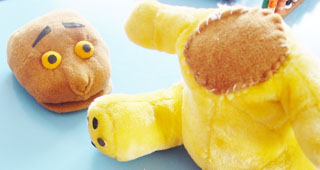

Werkwijze: 
De basis van de Gruf is een gekochte tweedehands teddiebeer, waar ik de kop en ook de benen heb afgehaald , omdat hij zat en niet stond. Dat doe je natuurlijk niet waar kleine kinderen bij zijn. De gaten die hierbij ontstaan kunnen het beste meteen worden dichtgenaaid met een lapje, zodat de vulling er niet uit gaat. 

 
De kop wordt van 2 stukken schuimrubber gemaakt met uitgeholde ruimte om de hand erin te steken.

 
Het afsnijden van de stukken gaat het beste met een afbreekmesje, de vorm van de kop kan worden geknipt.

 
Van dubbelgevouwen karton wordt de binnenkant van de bek gemaakt. Het karton wordt eerst rondom met stof overtrokken en daarna met grove steken vastgezet op het schuimrubber.

 
Nadat beide kophelften met stof zijn overtrokken.. 
 
..wordt een (dubbel) driehoekje stof in beide mondhoeken genaaid, zodat de bek niet te ver open kan gaan.

 
De details worden op de kop aangebracht.

 
Het lijf en de benen worden overtrokken met stof. 
Daarna wordt de kop op het lijf genaaid met een [flanelsteek](</files/De Flanelsteek.doc>). 
 
De stekels zijn van vilt, iets opgevuld.

 
Met viltstiften en acrylverf wordt het een echte Gruf.
