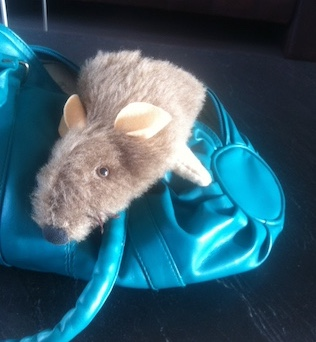

Klik op de afbeelding van het patroon hieronder voor een A4-formaat van het patroon en print het. 

 
Knip het lijf van de muis 2x (+ een zoom) uit  harige stof. Knip gleuven op de aangegeven plek voor de voorpootjes. 

Knip 2x een oor uit roze vilt (of een schoonmaakdoekje: veel goedkoper). Naai de vouw erin en frummel de oren op de goede plaats in de insnijdingen. Speld vast. Draai de muis binnenenstebuiten en kijk of de oren goed zitten (ze moeten hol aan de voorkant zijn, dus met de uitstulping naar het achterlijf gericht).  Naai nu het lijf, met de harige kant naar binnen. Laat het rechte stuk open, sla dit eventueel om voor een zoom. 
Naai de pootjes dicht (behalve het rechte stuk) en keer eventueel om (ik heb dat niet gedaan). Steek de voorpootjes in de gleuf, speld aan de binnenkant van het lijf vast en naai ze rondom aan het lijf. Speld de achterpootjes op de juiste plek en naai aan de buitenkant vast. 
Maak oogjes van een kraal of knoop en borduur eventueel de neus zwart of zet daar een grotere kraal of zwarte knoop op. Knip het bont rondom de ogen en van het snuitje een beetje kaal. Je kunt ook nog snorharen maken met een paar draadjes garen. Vouw de staart dubbel, naai en zet aan de boven-achterkant vast.

<iframe width="320" height="315" src="https://www.youtube.com/embed/aRNKi4eTXpk" frameborder="0" allowfullscreen></iframe>

Een variatie op dit patroon: Pop-up Muis uit handtas. 
 
De muis-uit-de-handtas act bestond  eruit dat ik als oud dametje heel onschuldig met één hand in de weer was met een zakdoekje dat ik uit de tas haalde, tot opeens de muis uit de tas tevoorschijn kwam (met de andere hand). 
De muis wordt op dezelfde manier gemaakt als hierboven. Maten patroon aanpassen aan de hand die hem gaat bespelen. Het lijf verlengen met een stuk soepele tricotstof (bijvoorbeeld een mouw) in bijpassende kleur. Er komt een gat in de zijkant van de tas. Hierin wordt de mouw vastgezet. Met de hand door het gat en de mouw heen wordt de muis dan bewogen.
