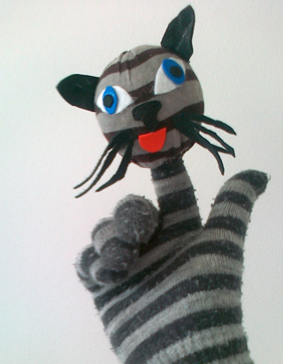
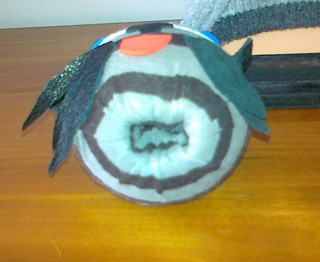

Deze kat bestaat uit een versierde bal op een bijpassende handschoen.
 Maak een gat in de bal waar de wijsvinger ruim door kan (Let op! Een tennisbal bewerken met een Stanley-mes valt niet mee, neem liever een rubber bal). Knip de teen van een sok en trek die over de bal, eventueel de bal met lijm insmeren. Stop de overblijvende stof naar binnen.

Rol wat karton om de wijsvinger en zet het rolletje met plakband vast. Zet met lijm vast in de opening in de bal en knip af vlak onder de balrand (nekje). Zorg dat de sok zo strak mogelijk om de bal blijft zitten. Als de lijm droog is, kan dit nekje eventueel in de juiste kleur geschilderd worden. Versier de kop met stukjes vilt en maak een staart.
 Probeer ook andere dieren!!

