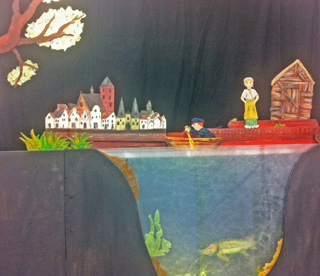
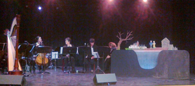

*Deze voorstelling is verkocht aan het Centrum voor Cultuureducatie Quintus in Kampen.*

Wie (van de oudere generatie) is niet opgegroeid met ["Piggelmee en het Tovervisje"](/piggelmee)?
 Minder bekend is dat dit commerciële  verhaaltje gebaseerd is op het veel oudere sprookje "Van de Visser en zijn Vrouw" (Grimm), dat overal in Nederland (en daarbuiten) werd verteld.
 Poppentheater Peterselie heeft  het sprookje omgezet ([hier](/verhaalvisser) te lezen)  en maakte er vervolgens  een erfgoed-voorstelling met poppen van. De visser heet nu Doevekater en zijn hebberige vrouw Pieternel.
 Het speelt zich af tegen de achtergrond van een oud-Hollands stadje aan het water en de steeds deftiger wordende huizen laten de geschiedenis van zo'n stadje goed zien. Ook de kleren van het vrouwtje volgen de geschiedenis.
 Interactief, met live muziek van een orkestje van Quintus Kampen of met opgenomen trekhamonicamuziek.

Thema's: dieren, huizen, beroepen, menselijk gedrag, sprookjes, water.
 Sluit aan bij de vakken: Nederlands, Geschiedenis, Kunsteducatie (Muziek, Drama, Erfgoed).
 Het liedje dat tijdens de voorstelling wordt gezongen staat
[hier](http://www.peterselie.nl/liedjevisser).

Leeftijd: 6 tot 10 jaar
 Max aantal kinderen: 60 (bij oplopende zitplaatsen)
 Liefst een LAAG podium
 Tijdsduur: 30-35 minuten
 Klik [hier](/affichetovervis) voor een affiche.

 De voorstelling werd oorspronkelijk een aantal jaren als schoolvoorstelling opgevoerd samen met 7 muziekdocenten van kunst-educatiecentrum Quintus in Kampen. Het orkest speelde een aantal korte klassieke stukken en begeleidde de liedjes.
 Uit de evaluatieformulieren van de scholen die de voorstelling bezocht hebben kwam als cijfer: een 8!!

<iframe width="320" height="315" src="https://www.youtube.com/embed/HtxXA3PaCc4" frameborder="0" allowfullscreen></iframe>

Foto's van het maakproces van de voorstelling staan [hier](/makingvisser).

[Hier](/knipplaatVisser) staat de voorstelling als bouwplaat, om het verhaal zelf na te kunnen spelen.
