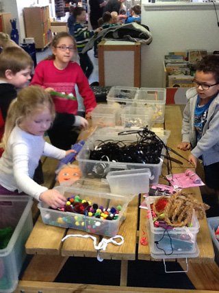

 Klik [hier](/afficheheksen) voor een affiche.

Deze voorstelling wordt helaas  niet meer gespeeld.

Eerst wordt het gedicht "Tien kleine heksjes" door Peterselie voorgedragen.
 Dan maakt iedereen een heksen-stokpop. We proberen met het aanbrengen van allerlei details er helemaal onze eigen pop van te maken.
 Met attributen en extra poppen die Peterselie heeft meegebracht wordt vanachter een scherm het gedicht opgevoerd, iedereen met zijn eigen pop.
 Bij de meegebrachte spullen zitten een aantal voorbeelden van andere poppentechnieken, zodat daar ook kennis mee gemaakt kan worden.
 Geschikt voor basisschoolkinderen (ideaal voor groep 3/4), wel met hulp van extra volwassenen.
 Ook bedoeld voor studenten en mensen die werken in onderwijs of kinderopvang. Dit wordt dan meestal gedaan als onderdeel van een lezing.
 Niveau en vorm kan aan allerlei groepen worden aangepast.

De prijs voor een meedoe-workshop is bij minder dan 20 deelnemers vanaf €275,- excl.
 Bij groepen groter dan 20 personen komt de prijs voor extra materiaal erbij.

 Buitenschoolse activiteit, Kampen

Introductiedag 3e jaars studenten ROC Emmeloord

<iframe width="320" height="315" src="https://www.youtube.com/embed/Z0nNHxDpCag" frameborder="0" allowfullscreen></iframe> 
Meespelen met eigen pop. Buitenschoolse activiteit Brunnepe.

