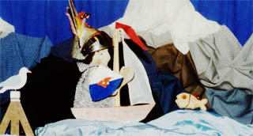
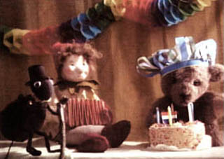
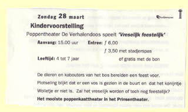

Voordat Poppentheater Peterselie werd opgericht, maakte Marjanne Peters deel uit van Poppentheater de Verhalendoos. De Verhalendoos heeft een kort maar heftig leven geleid. Er kan teruggekeken worden op succesvolle producties als: 'De reizen van Jan en de Prins', 'Help, daar vliegt een draak!', 'De Kikvorst' (geinspireerd door een verhaal van Annie M. G. Schmidt), de kaskraker 'Gaatjes in je tong' naar het boek 'Sporen in het zand en gaatjes in je tong', van Gré van der Veen (ism Zeehondencreche Pieterburen), 'Op zoek naar Koning Winter', en de laatste voorstelling 'Vreselijk Feestelijk'.
 Een grote schare fans heeft altijd erg meegeleefd, vooral toen de try-outs in het 'huistheater' in Oostwold, waar medespeelster Eva woonde, gerealiseerd werden.
 Helaas kwam een einde aan de samenwerking toen Eva verhuisde. Gelukkig heeft TVNoord een filmpje gemaakt over Poppentheater de Verhalendoos in opdracht van het Prins Bernhard Cultuurfonds:

<iframe src="https://www.youtube.com/embed/WEiHonObf7M?ecver=2" width="320" height="360" frameborder="0" style="position:absolute;width:100%;height:100%;left:0" allowfullscreen></iframe>

filmpje over "Gaatjes in je tong"

 Gaatjes in je tong (affiche gemaakt door <a>Geert Schreuder</a>)

 Op zoek naar Koning Winter

 Help, daar vliegt een draak!

 Vreselijk feestelijk

<iframe src="https://www.youtube.com/embed/oBQt-E3sBOE?ecver=2" width="320" height="360" frameborder="0" style="position:absolute;width:100%;height:100%;left:0" allowfullscreen></iframe>

