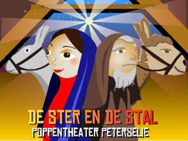
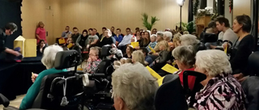
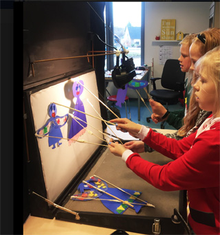
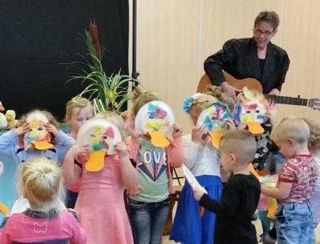

Peterselie heeft een project ontwikkeld waarbij kinderen en ouderen  samen meedoen aan het Kerstverhaal van Poppentheater Peterselie.
 Van te voren worden met de deelnemers poppen gemaakt tijdens een workshop.
 Als Peterselie het kerstverhaal speelt, kunnen kinderen en ouderen actief meespelen en meezingen.

Het doel is om kinderen en ouderen in contact met elkaar te laten komen en om beiden te betrekken bij cultuur.
 Tot nu toe zijn er projecten geweest met (licht) demente bejaarden samen met peuters, en met kinderen uit groep 8 met senioren die nog zelfstandig wonen.

 Voorstelling bij Myosotis, Kampen, Kerst 2016.
 Mogelijk gemaakt door een bijdrage van Cultuurfonds Kampen.

 Workshop waarbij kinderen en senioren samen de herders voor het Kerstspel maken (2018)

 Groep 8 maakt schimmen-engelen

 Tijdens de Kerstvoorstelling voor de hele school.

Zie voor de liedjes en de voorstelling zoals Peterselie die speelt [Kerstvoorstelling](http://www.peterselie.nl/kerstvoorstelling)

Soms kunnen ook andere voorstellingen omgezet worden in een intergenerationele voorstelling, zoals hier bij "Alle eendjes..." (senioren en peuters).

