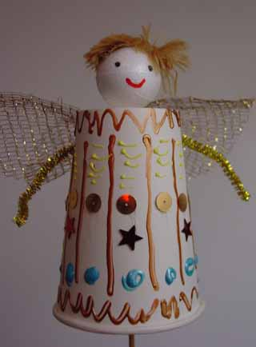
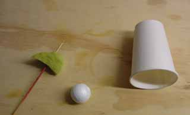

 
Wat heb je nodig voor dit stokpopje? 
papieren bekertje 
sate-prikker 
stukje schuimrubber 
piepschuim bolletje of bolletje gemaakt van een rondje rekbare stof met wat vulling dichtgebonden 
pijperager voor armen 
kant of tule of plastic isolatiemateriaal voor vleugels 
glittertjes en sterretjes als versiering 
wol of katoen voor de haren

 
Hoe maak je het? 
Prik het stukje schuimrubber op de sate-prikker . Prik dan de sate-prikker van binnen uit door de bodem van het papieren bekertje. 
Zet het piepschuimbolletje er boven op. 
Plak de vleugels achterop en versier de engel verder.
