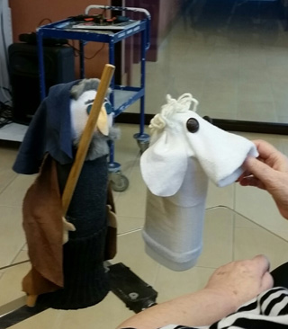
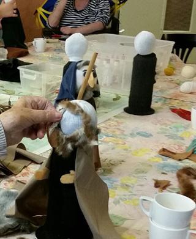

Maak volgens dit eenvoudige systeem een hele Kerstgroep! 
Hier volgt een globale beschrijving: 
 
Vul de teen van een sok met vulsel en bind daarna af.

 
Plak een oude CD onder een lege plastic  fles (hobbylijm). Zo blijft de pop goed staan.

 
Trek de sok strak over de fles. Meestal blijft het vanzelf zitten, als je het over de CD hebt getrokken. Anders nog even wat lijm ertussen. 
Verder is het een kwestie van wat lapjes erop plakken en versieren naar goeddunken.... 
Echte armen heeft hij niet, de handen worden aan de cape en op het lijf geplakt. 

Voorbereidingen voor kerst-meedoevoorstelling: 
 

