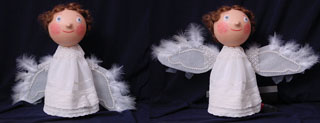
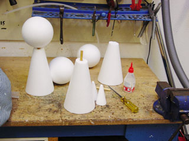
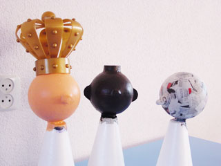

Van piepschuim pionnen (ongeveer 25 cm hoog) wordt 5 cm van de bovenkant afgezaagd, onder diverse hoeken. Een rond stokje van een cm of 5 wordt met houtlijm of hobbielijm eerst in de pion en daarna in de kop gelijmd (gat prikken met het stokje). Er zijn diverse houdingen van het hoofd mogelijk!

Met crepe-tape (schilders-plakband) worden diverse neuzen (het afgezaagde topje van de pion, kurk, kralen enz.) en eventueel oren op het gezicht geplakt.

Kwast het hoofd en de nek in met behangerslijm en plak er stukjes krant op.
 Als het eenmaal helemaal beplakt is, laten drogen. Daarna een laagje dunne plakkaatverf aanbrengen, dan kan deze laag papier onderscheiden worden van de volgende.
 Laat drogen.
 Herhaal dit nog 2 keer. Beschilder met acrylverf (huidkleur).

Maak het gezicht af door er vilt, bont en wol op te plakken. Schilder eventueel wangen, wenkbrauwen enz.

Kleed de pop aan.

Omdat ik vragen kreeg over het mechaniek achter de vleugels van de engel, hierbij het geheim: ik heb een kurkentrekker (wit) op de rug bevestigd voor ik de jurk  aandeed, met de punt richting het hoofd. De bewegende punt worden door het jurkje gestoken. Daarna kunnen de vleugels op de punten geplakt/genaaid worden Trek onder de rok aan het rondje om de engel te laten vliegen!

