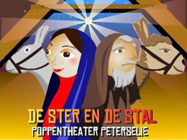
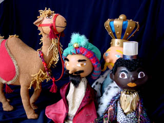
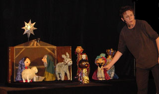

Met als leidraad bekende kerstliedjes wordt in eenvoudige taal het kerstverhaal verteld, geillustreerd door grote, staande poppen.

Deze Kerstvoorstelling is al gespeeld op zeer diverse plaatsen: in kerken, bij kinderdagverblijven, op scholen, bij instellingen voor mensen met een verstandelijke beperking, bij mensen met een dementie, in onze eigen schuur en ook een keer voor een groep moslim-ouders van een school in de Schilderswijk in Den Haag (met enorm succes!).
 De voorstelling kan ook gespeeld worden met pauzes tussen de afzonderlijke stukken:
 \- Maria en de Engel
 \- Geboorte in de stal
 \- De Herders
 \- De Wijzen uit het Oosten

[Klik hier voor de liedjes](/kerstliedjes) die gezongen worden.
 De muziek van het dansje dat Maria en Jozef in de voorstelling doen is gecomponeerd door broer [Ton Peters](/soms).

duur: 30 minuten
 opbouwen: 2 uur
 nodig: 2 kantoortafels (van ongeveer 1.10m x 1.30m)
 verduisterde zaal
 bezoekers: tot 100
 oplopende zitplaatsen
 geen of zeer laag podium
 hulp bij uit- en inpakken
 indertijd speciaal gemaakt voor mensen met een verstandelijk beperking, maar ook geschikt (aangepast, met aangepaste liedjes) voor peuters of als familievoorstelling.
 prijs: €425,- excl BTW (in de 3 noordelijke provincies is de prijs €375,- ex BTW)
 reiskosten: €0.40/km
 Klik [hier](/affichekerst) voor een affiche.

[Zelf dit soort poppen maken](/kerstpoppenmaken)

Registratie van "De Ster en de Stal" in de kerk van Grolloo, op 25 dec. 2018.
 Niet geheel vlekkeloos, en verkouden stem, maar och...

<iframe width="320" height="315" src="https://www.youtube.com/embed/kwpYc_aICZI" frameborder="0" allowfullscreen></iframe>

