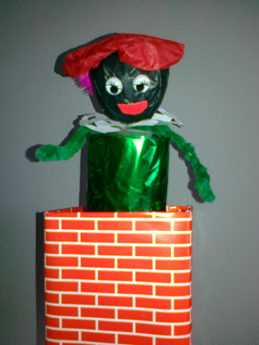
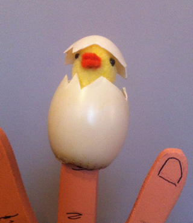
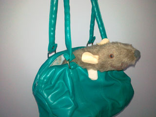
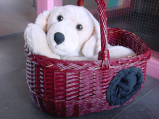

Een kiekeboe-popje is handig in de klas (bijvoorbeeld als klassenvriendje bij het kringgesprek), bij de dokter (om een kind even af te leiden), in het bejaardenhuis (bijvoorbeeld de hond op de foto hieronder als aaiobject), om een verhaal mee te vertellen enz. enz.

In deze workshop maken we een kiekeboe-popje, waarbij de keuze afhankelijk is van het toekomstige gebruik, de beschikbare tijd, het seizoen en de mate van handigheid van de groep (er zijn hele gemakkelijke!!).

Hieronder een paar voorbeelden:

 De doehetzelf-beschrijving staat op: [Kiekeboevogel](http://www.peterselie.nl/kiekeboevogel)

 Beschrijving: [Zwarte Piet pop-up](http://www.peterselie.nl/popuppiet)

 Beschrijving: [Kuiken uit ei](http://www.peterselie.nl/kuiken)

<iframe width="320" height="315" src="https://www.youtube.com/embed/KKxJG4BChIM" frameborder="0" allowfullscreen></iframe>

 Knuffel-in-doos-popup.

 Knuffel-in-tas (een handpop). Zakdoekje zoeken in je handtas en plotseling komt er een muis uit!

 Dit is een knuffel-in-mand, voor de handigerds onder ons!
