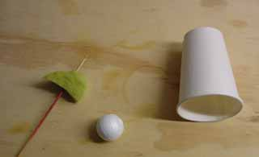
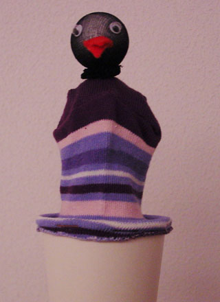

Wat heb je nodig voor de kiekeboevogel? 
papieren bekertje 
sate-stokje 
stukje schuimrubber 
piepschuim bolletje 
stukje nylonkous of dun tricot 
teenstuk van een sok 
knoopjes of rokoogjes 
wiebertje vilt voor snaveltje 
afbindgaren 
lijm 
nietmachine 
versierselen 

 
Hoe maak je het? 
Steek de sate-prikker door de bodem. Prik daarna het stukje schuimrubber op de prikker. 
 
Schuif het stokje met het schuimrubber terug in het bekertje. Niet de sokteen met de afgeknipte kant aan de bovenrand van het bekertje. 
Steek het stokje daarna door de punt van de teen, ver genoeg om er het piepschuim bolletje op te prikken (eerst wat lijm op de bovenkant van de prikker doen). Doe het stukje nylonkous om  het bolletje en bind het nekje af met een stevige draad.. 
Duw het bolletje tegen het stukje schuimrubber van binnen. 
Plak er de oogjes op. Snaveltje dubbelvouwen en opplakken en versier verder.

Versier ook het bekertje of maak er een nestje van.
