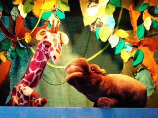

Jammer, deze voorstelling wordt niet meer gespeeld.

Klalana is een Afrikaans meisje dat haar vader redt van de gevaarlijke Dansdraak door zelf beslissingen te nemen en niet zomaar te geloven wat anderen zeggen.

Er is een educatief voorafje, waarin getoond wordt wat er in Afrika zoal gegeten wordt, hoe de vrouwen hun manden dragen, welke kleren gedragen worden, enz. Ook wordt een Afrikaans lied aangeleerd.

Klik [hier](<http://www.peterselie.nl/files/Lesbrief Klalanaencr.pdf>) voor de lesbrief met liedjes, recepten en knutsels. Het downloaden kan even duren. Kijk ook bij [kleurplaten](/kleurplaten).

Ontwerp affiche: Boris Reuderink

 Een jonge Peterselie in Afrika
