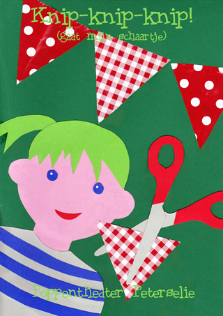
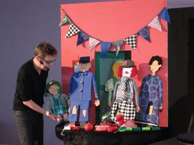

VERKOCHT

Interactieve vertelvoorstelling met poppen en veel liedjes, begeleid op de trekharmonica.

Pien verveelt zich en gaat een verjaarsfeestje voor zichzelf organiseren. Dino en Slang en Rode Kikker zullen ook komen. Maar ja, ze heeft geen slinger. Haar moeder die druk is en niet goed oplet, geeft haar toestemming om een slinger te knippen, maar heeft niet door, dat Pien de vlaggetjes voor de slinger uit allerlei kleren gaat knippen. 
Pien krijgt natuurlijk aan het eind wel een standje, maar niet zo'n grote. En haar moeder zal voortaan zorgen dat ze het minder druk heeft en dus beter op Pien kan letten! 
En zo  wordt het toch nog een leuk feestje.

Het liedje dat tijdens de voorstelling wordt gezongen staat 
[hier](http://www.peterselie.nl/knipliedje). 

Leeftijd: geschikt voor peuters en kleuters. 
Voor kleine groepjes is er [korting](/korting). 
Duur: afhankelijk van de reacties van de kinderen duurt deze voorstelling 30 tot 40 min. 
Klik [hier](/afficheknip) voor een affiche.

<iframe width="320" height="315" src="https://www.youtube.com/embed/6OiRNcD701k" frameborder="0" allowfullscreen></iframe> 
Beetje ver weg opgenomen, maar geeft wel een indruk.

