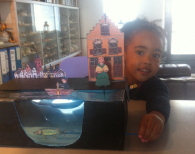
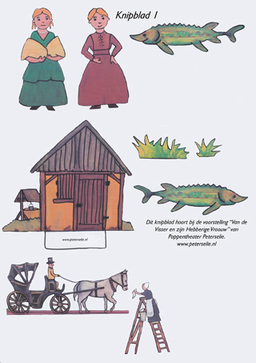
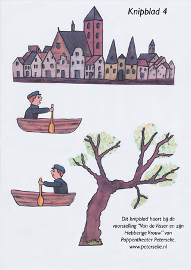
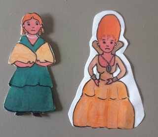
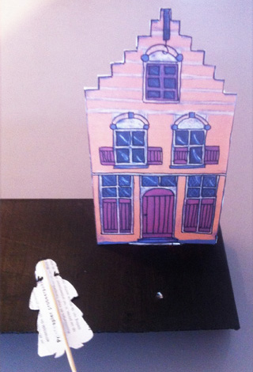
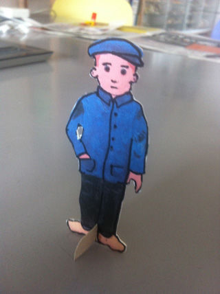

Alle rechten van deze ontwerpen berusten bij Poppentheater Peterselie. 
Voor eigen gebruik mogen de pdf's worden geprint, maar voor professioneel gebruik is toestemming nodig!

**De knipplaten** 
Klik op de plaatjes voor een printbare versie.

**Werkwijze** 
Print de knipplaten op A4 of A3. A4 is priegeliger, maar past wel mooi op een grote schoenendoos. Neem wit karton als printpapier, of plak de prints (van gewoon printpapier) op wit karton. Zorg bij het lijmen, dat elke milimeter wordt geraakt, omdat sommige onderdelen heel klein zijn en dan na het knippen soms niet vast blijken te zitten. Het geschikste hiervoor vind ik een Pritt-stift. 
Je kunt de onderdelen uitknippen met een fijn schaartje of snijden met een breekmesje.

Je kunt dat heel precies doen, maar ook grof, met een rand wit eromheen (maar doe dan alles grof, zodat het in één stijl blijft). Zorg er ook voor, dat alle onderkanten zonder witte rand worden uitgeknipt.

**Voor het verhaal zijn natuurlijk niet alle onderdelen nodig. Je kunt volstaan met het uitknippen van het mannetje, alle vrouwtjes, alle huizen, het mannetje in het bootje (2x) en de vis die naar links zwemt.**

Knip uit een schoenendoos (of grotere doos, bij A3), uit de voorkant het "water". Laat ruimte over boven de bodem (de vis kan dan langs de bodem onzichtbaar teruggetrokken worden). Schilder de doos (of beplak met papier). Zwart is lekker neutraal, maar iets anders kan natuurlijk ook. Zorg dat het wel bij het geheel past. Plak voor de wateropening een stuk dun helder plastic (iets groter dan de opening) aan de binnenkant van de doos.

Maak aan de rechterzijkant met een breekmesje een gleuf, waar de vis aan de satéprikker door kan (tijdens het spelen kan de vis gewoon buiten zicht op de bodem blijven liggen). De gleuf niet helemaal tot de bovenkant van de doos laten doorlopen. 
**Deze gleuf is niet nodig als je de vis van bovenaf bedient (dus met een satéprikker vanuit de rug omhoog). Hij kan dan echt terug zwemmen, door hem om te draaien. Voor deze mogelijkheid de vis die naar rechts zwemt ook uitknippen en op de achterkant plakken.** 
Plak over de voorste helft van de open bovenkant van de doos een strook plastic die iets breder moet zijn dan de helft van de doos en aan de zijkanten genoeg flap moet hebben om vast te plakken (aan de buitenkant, anders gaat het plastic "hangen"!). Laat aan de voorkant een opening van een cm vrij (zodat het net (een sinaasappelnetje) uitgegooid kan worden en de vis eventueel van boven bediend kan worden). Knip de gleuf bij als dat nodig is.

Knip het deksel in 2-en. Laat de rand eraan zitten. Verf of beplak  één van de dekseldelen in dezelfde kleur als de buitenkant van de doos. Doe de deksel (zoals die oorspronkelijk ook zat) over de achterzijde. Maak aan de rechter-achterkant, op 1/3 van de breedte, een snede, zo lang als de flap aan de onderkant van de achtereenvolgende huizen breed is. Om de gleuf gladder te maken kun je om de randen plakband plakken, maar maak de snede niet breder, want dan blijven de huizen niet rechtop staan.

Maak aan de achterkant van de vrouwtjes een satéprikker (cocktailprikker) vast met plakband en maak een gaatje, midden tussen het huis en het water, om de vrouwtjes in te zetten. Als je het mooi vindt, kun je de prikker eerst zwart verven. 
Als je de dieren, de koets en de dienstbode ook gebruikt, kun je daar ook satéprikkers achter plakken. Maak hiervoor dan nog gaatjes op plekken die je daar voor vindt passen. 
De achtergrond (het stadsgezicht) kan links achter de deksel worden geplakt. De boom aan de binnenkant van de doos, links voor. 
Het mannetje heeft een standaardje, zodat hij overal kan gaan en staan. Maak dit eventueel zwart met een viltstift, en het papier tussen zijn klompjes ook.

Plak de 2 delen van het mannetje in de boot aan elkaar bij: hoofd en de voor- en achtersteven van het bootje. Als de lijm droog is, het middenstuk uit elkaar buigen en er een klein stukje kurk inplakken, zodat het open blijft staan.

Poppentheater Peterselie heeft voor de voorstelling waarop deze papiertheaterversie is gebaseerd een bewerking van het sprookje: "Van de Visser en zijn Vrouw" van Grimm gemaakt. Die bewerking is [hier](/verhaalvisser) te lezen. 
Informatie over de "echte" voorstelling staat [hier](/hebberigevrouw).
