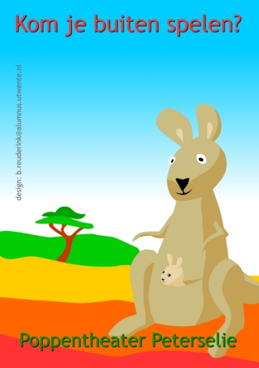

 
affiche: Boris Reuderink

Kareltje Kangoeroe  en zijn moeder wonen in de dierentuin. 
Kareltje wil het liefst in de buidel bij zijn mama blijven, lekker veilig. 
Aan het eind van de voorstelling vindt Kareltje het niet alleen leuk te zijn  om met een ander kangoeroetje te spelen, maar alle andere dieren uit de dierentuin worden ook vriendjes van Kareltje Kangoeroe!

Interactieve vertelvoorstelling met tafelpoppen. Natuurlijk met heel veel [liedjes](/files/Kangoeroelied.doc) ([muziekfragment](http://www.peterselie.nl/files/beweeg_als_een_dier.mp3)) en bewegings-spelletjes! 
Klik [hier](/affichekangoeroe) voor een affiche.

leeftijd: 2 tot 6 jaar (peuters en kleuters liefst niet tegelijk) 
geschikt voor verstandelijk gehandicapten 
duur: 35 tot 45 minuten, opbouwen 1 uur 
speelvlak: 3 x 3 meter 
oplopende zitplaatsen 
niet te grote ruimte waar geen andere activiteit plaatsvindt, ook geen open bar 
prijs: op aanvraag 
reiskosten: €0.30/km 
maximale aantal peuters of kleuters: 45 (met eventueel 45 ouders) 
[Technische gegevens.doc](<https://peterselie.nl/files/Technische gegevens.doc> "Download: Technische gegevens.doc (32.5 KB)")

Voor kleine groepjes (minder dan 30 kinderen) is het onder speciale [voorwaarden](/korting) mogelijk om korting te krijgen. 

 
foto: Bibliotheek Hengelo

 
foto: Bibliotheek Utrecht

<iframe width="320" height="315" src="https://www.youtube.com/embed/Ufj30xiyJ90" frameborder="0" allowfullscreen></iframe>

