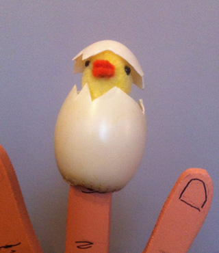
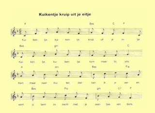

Een kuiken-vingerpopje met een liedje!

Laat eerst het dichte ei zien, vouw je handen er omheen. Zing dan het liedje met de kinderen en laat, als het uit is, het kuikentje uit het ei komen.

Benodigheden:
 \- plastic ei
 \- stukje gele stof
 \- 2 zwarte kraaltjes
 \- restje oranje vilt
 \- vulsel
 \- breekmesje
 \- naaigerei

Snij in de onderkant van het ei een rond gat, waar je vinger ruim door kan. Snij de bovenkant zigzaggend eraf:

Teken de ruime omtrek van je vinger en knip dit patroon 2x uit gele stof, met een extra zoompje. Naai het tot een kokertje. Rijg een nekje, trek de draad wat aan en vul het kopje met vulling. Naai 2 zwarte kraaltjes op de plek van de oogjes. Snaveltje knippen uit vilt, dubbelvouwen en op kopje naaien/plakken.

Onderkant kuikentje in onderkant ei vastnaaien (probeer of de goede kant er boven uit komt steken). Dopje op kopje van kuikentje plakken (zorg dat de jusite puntjes weer op elkaar komen als het ei "dicht" is).

Het is natuurlijk niet de bedoeling om het kuikentje + ei zo omhoog te houden als ik hierboven boven op de foto doe. Het ei moet min of meer in de palm van één hand liggen, met de andere hand er beschermend onder/omheen.
 Zing het liedje met het dichte ei in de handpalm en laat, wanneer het liedje klaar is, het kuiken uit het ei komen.
