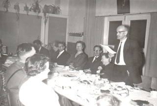
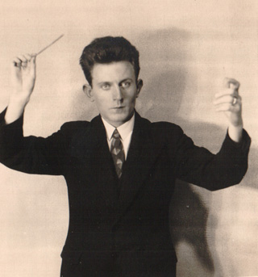
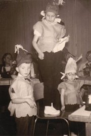
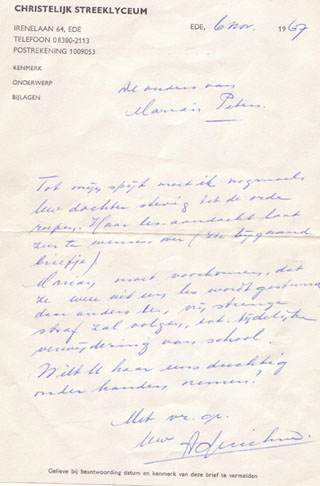
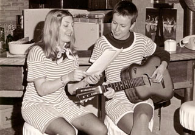
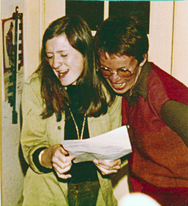
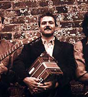

Feitjes uit mijn leven, voor zover deze misschien iets  te maken hebben met mijn keuze om een poppenspeler (die veel muziek maakt tijdens de voorstellingen) te worden. Een soortement CV dus.
 Documenten kunnen worden vergroot door erop te klikken.

 Zo zeg, dat poppenspelen zat er al vroeg in!

Helaas, dit was uitsluitend voor de foto: ik speelde nooit met poppen.
 Maar ik kom wel uit een familie van amateur-podiumdieren.
 Opa van moeders kant stond bekend om zijn gedichten op bruiloften en partijen en ook blies hij een leuk nummertje hoorn.

Mijn vader met zijn broers en neven waren berucht vanwege hun grappen en grollen op feesten.  Pa was ook een begenadigd spreker.

 Klik op de foto voor vergroting: Pa (Ant.) en broer Arie actief op een avond van de jongelingsvereniging Benjamin.

Oom Arie was een professional in de kunsten: o.a. organist van de St. Bavo in Haarlem en vaste bespeler van het carillon van de Domtoren in Utrecht.

[Oom Arie speelt Psalm 33.mp3](<https://peterselie.nl/files/Oom Arie speelt Psalm 33.mp3> "Download: Oom Arie speelt Psalm 33.mp3 (307.66 KB)")

Maar dit  alles gold alleen voor de mannelijke lijn. Bijna alle voorouderlijke vrouwen waren podiumvrezig, behalve tante Metje (maar die was dan ook aangetrouwd), die graag achter de piano excelleerde, een vrouwenkoortje leidde en (sterk aangemoedigd door Ma) mij ook tussen de schuifdeuren joeg:

[Ikbenmarjan.mp3](https://peterselie.nl/files/Ikbenmarjan_0.mp3 "Download: Ikbenmarjan.mp3 (2.23 MB)")

Als mijn vader en moeder 's avonds niet thuis waren, vertelde ik zelf-verzonnen verhalen aan mijn broer en zus, samen in het grote bed. Mijn zus herinnert zich het verhaal over een worst en een pruik nog steeds, ik niet.

Toen ik een jaar of 9 was, hoorde ik bij de zandbak achter ons huis een meisje "Weet je dat er sprookjes zijn" zingen, zichzelf begeleidend op de gitaar. Dat wilde ik ook!
 Slim zei mijn moeder dat ik dan eerst orgelles moest nemen. Een orgel stond tenslotte al in de huiskamer. Samen met de blokfluitjes van broer en zus geschikt voor familiefeestjes:
[orgel+blokfluit.mp3](https://peterselie.nl/files/orgel+blokfluit.mp3 "Download: orgel+blokfluit.mp3 (608.57 KB)")

Na jarenlange orgel-terreur door docente Xantippe van Z. en veel oefenen onder leiding van Opa die dan met de vlakke hand hard de maat op het harmonium sloeg, mocht ik dan op mijn 12e op gitaarles. Ik was inmiddels vergeten dat ik dat wilde.
 Ik kreeg een "gitaar", type sigarenkist en er volgde les op de Muziekschool.

Daarna waren er nog de gitaarlessen van juffer Rozenboom (door ons kinderen Bozedroom genoemd), maar het "Weet je dat er sprookjes zijn"-gevoel is nooit meer teruggekomen.
 Ik kreeg een betere gitaar in Milaan, nadat ik vanaf Rimini in de auto had gejankt omdat vakantieliefde Roberto daar achterbleef. Ik had net een week hotelkamerarrest achter de rug, omdat ik via een raam aan de achterkant was ontsnapt om met hem te wandelen. Tante Jos ontdekte ons onder een lantarenpaal, waar ik de geneugten van het tongzoenen voor het eerst aan het onderzoeken was. Zij beet Roberto toe "dat  Hollandse meisjes zoiets niet deden" (haha)!

HBS-b: 1964 - 1971
 Is dat niet wat lang? Tja, creatief ontwikkelingsproces......

 Tekst brief rector:
 Tot mijn spijt moet ik nogmaals uw dochter stevig tot de orde roepen. Haar les-aandacht laat zeer te wensen over (zie bijgaand briefje).
 Marian moet voorkomen, dat ze weer uit de les wordt gestuurd, daar anders  een vrij stevige straf zal volgen, zoals tijdelijke verwijdering van school.
 Wilt u haar eens duchtig onder handen nemen?

Dat van school sturen is natuurlijk uiteindelijk toch wel gebeurd....

<iframe src="https://www.youtube.com/embed/XONmUCEtW1Y?ecver=2" width="320" height="360" frameborder="0" style="position:absolute;width:100%;height:100%;left:0" allowfullscreen></iframe>

eindexamen

 Jinks en Yogi zingen het beruchte "Lied voor klas 2a" op een reünie.

Hier een paar fragmentjes:
[YogiJinks.mp3](https://peterselie.nl/files/YogiJinks.mp3 "Download: YogiJinks.mp3 (1.7 MB)")
 Opgenomen bij een bezoekje op rijpere leeftijd....

Het laatste deel (niet op de opname):
 "En straks hebben we veel grijze haren,
 hoewel som’gen misschien ook wel kaal zijn
 (worden, blijven, blijken, heten, dunken en voorkomen)
 Maar wij blijven elkander beminnen,
 Lalalalalalalalalala!"

Iedereen in die klas had een bijnaam. Het noemen van de echte naam werd bestraft met een geldboete. Jinks en ik noemen elkaar nog steeds alleen maar bij de bijnaam.
 We schreven ook samen een (later door ons vernietigd) boek. Jinks is schrijfster geworden (en illustrator).
 Mijn (sporadisch overgebleven) schrijfsels staan [hier](http://www.peterselie.nl/schrijven) onder Verhalen/gedichten.

 Opleiding Cultureel Werk, Middeloo, Amersfoort (1971-1975)

Op Middeloo had ik in het eerste jaar het vak: "Spelen met objecten". De poppenspel-vonk is toen overigens niet overgeslagen.
 Ook waren er "optredens" buiten school. Hier voeren Elly N. en ik een  speciaal op onze kado's toegespitst gedicht op, voor de verjaardag van haar vriend Roos (we waren wel erg duidelijk geïnspireerd door Paul van Ostayen!).
 Het laatste deel van dit vers luidde:

Reuzeke Rozeke
 Zoetekoeksdozeke
 Appelmoesschaleke
 Neem 't ons niet kwalijke
 Dit schoon verhaleke
 Appelepap
 Was maar een grap!

En daar gaan we weer op bruiloften en partijen:

En nog eens........

...en nog eens.......

....en nog eens.........

Hier doe ik met mijn broer en zus (de rokjes nog uit onze kindertijd!) een stukje cabaret over onze (afwezige) seksuele opvoeding. Maar we hadden gelukkig dieren:
 \- Moeder Duif deed het met haar zoon.
 \- Hond kreeg betaald voor een vrijpartij.
 \- Vrouwtjesfazant werd na haar eerste ei een mannetje.
 \- De Kippen sprongen op elkaars rug.
 \- En de Schildpadden mochten op zondag niet "bonken" van Pa.
 Alleen neef Hans moest lachen.

Kenia en Indonesia kenden weinig momenten met spotlights. Het was meer een kwestie van basaal overleven, vooral met een baby.
 Alleen deze "Tulpen uit Amsterdam" staat mij bij, met wollen pakjes (ingevlogen uit Nederland door de ambassade in Jakarta) in de moordende hitte:

De kinderen gaan in Groningen naar de Vrije School. En ik als moeder dus naar de "ouderschool" voor een poppenkastpoppencursus. Niet al te lang daarna volgt de oprichting van Poppentheater de [Verhalendoos](http://www.peterselie.nl/historie).

Trekharmonicalessen van Immy Jager en Geert Oude Weernink:

[Chaos De Montpellier.m4a](<https://peterselie.nl/files/Chaos De Montpellier.m4a> "Download: Chaos De Montpellier.m4a (6.09 MB)")
 Geert speelt met Tarducci een zelfgecomponeerd nummer.

Eva, vriendin en collega in de Verhalendoos verhuist in 1993.
 Solotheater Peterselie is een feit: vertellen met poppen en meestal de trekharmonica erbij.

.....and that's all there is to know, folks!
