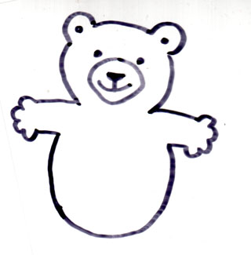
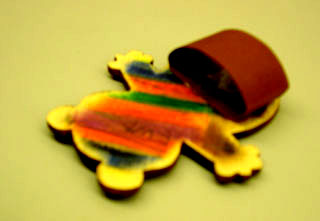

Kopieer het beertje en kleur het. Plak op karton en knip uit. 
Je kunt het natuurlijk ook natekenen, misschien zelfs naar je eigen smaak een beetje veranderen. Let op: de hoogte moet ongeveer 10 cm zijn. 
Als je erg handig bent, kun je hem ook uit triplex zagen met een figuurzaag. 
 
Aan de achterkant plak je een afgeknipt stuk van een lege wc-rol. Hier gaan 2 vingers door voor de beentjes. 

