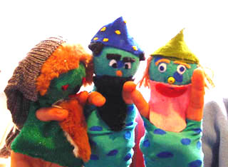

 
foto: Roc Den Helder

De student leert diverse soorten vlug-klaar poppen te maken en vooral om deze gebruiken in allerlei spelvormen. Per week 1 dagdeel, met huiswerk.

 
'Sneeuwwitje en de zeven dwergen': workshop 
poppenspel in de kinderopvang voor ROC Friesepoort. 
Het volgende filmpje is hier ook gemaakt: 
[cursussen1.MPG](https://peterselie.nl/files/cursussen1.MPG "Download: cursussen1.MPG (1.31 MB)")
