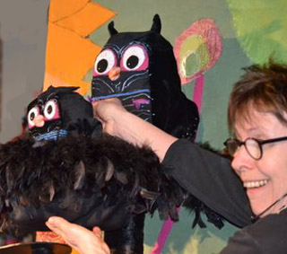

Helaas, deze voorstelling wordt niet meer gespeeld, omdat alles verkocht is aan een beginnend poppentheater!

 
Peutervoorstelling gebaseerd op het Prentenboek van het Jaar 2012.

 
Poppentheater Peterselie's versie van de figuren van "Mama kwijt!" 
De beschrijving van het maakproces van deze poppen staat [hier](http://www.peterselie.nl/flessenpop).

 
Peterselie-voorstelling: "Waar is mijn mama?"

 
[Hier](/tafeltheater) staan de patroontjes van de kartonnen verteltafelpopjes (ontwerp: Poppentheater Peterselie).

<iframe width="320" height="315" src="https://www.youtube.com/embed/7-4tFECAEqY" frameborder="0" allowfullscreen></iframe> 
Flipshare heeft een Magic Movie gemaakt (dus een vrij willekeurige keuze) uit de voorstelling "Waar is mijn mama", gespeeld in Bibliotheek Enschede.

