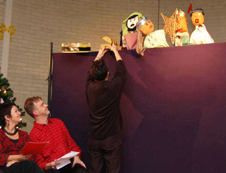

&#x2028; 
Het kerstverhaal met Poppentheater Peterselie, St. Opmaat in Bedum (foto: Klaas de Haan)

De meedoe-voorstellingen van Poppentheater Peterselie zijn, doordat ze aangepast worden aan de groep, voor meerdere doelgroepen geschikt: basisschoolkinderen, verstandelijk gehandicapten, studenten, groepsleiding, onderwijzend personeel enzovoort. 
De Kerst-meedoevoorstelling is ook beschikbaar als  [intergenerationele voorstelling (senioren samen met groepen kinderen)](/intergenerationelevoorstelling). 
Voor alle meedoe-voorstellingen geldt dat er eerst theaterpoppen worden gemaakt (verschillende soorten, aangepast aan de groep en de beschikbare tijd) en daarna spelen we met zijn allen het verhaal. De nadruk ligt op het plezier hebben en durven spelen.&#x2028; 
Er moet voldoende  extra begeleiding aanwezig zijn (en blijven). 
Voor het knutselen zijn tafels nodig, voor het uitspelen een (leeg) speellokaal of ruime lege hoek.

De prijs voor "Een dame en 10 poezen" en "De Prinses op de Erwt" is bij minder dan 20 deelnemers €175,-  excl. 
Bij groepen groter dan 20 personen komt de prijs voor extra materiaal erbij. 
"De Rattenvangster" (kan ook voor grotere groepen) kost €275,- exclusief. 
Voor het Kerstverhaal (2 workshops en 1 voorstelling) is de prijs in overleg. 
Reiskosten: €0,40/km

**Bovenstaande prijzen gelden voor de provincies Groningen, Friesland, Drenthe en Overijssel, voor de rest van het land komt er €50,- bij.**

De mogelijkheden zijn: 
[De Rattenvangster](/rattenvangster) 
&#x2028;[Het Kerstverhaal&#x2028;](/kerstmeedoevoorstelling) 
[Een dame en tien poezen&#x2028;](/poezen) 
[De Prinses op de Erwt](/erwt)

[Meedoevoorstelling Nog een keertje!](/beertjemeedoe) (archief) 
[Tien domme heksjes&#x2028; (archief)](/heksjes) 
[Tien kleine elfjes](/elven) (archief) 
[Ik ben niet bang voor een spook!&#x2028;](/spook) (archief) 
[Wij zijn Indianen, we gaan op berenjacht...](/indianen) (archief)
