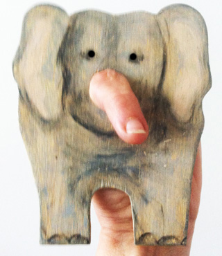

Deze olifant kan bijvoorbeeld banaantjes uitdelen of iemand een "slurfje" geven.

Vergroot het patroon hieronder tot het 1.20m hoog is. Zaag uit multiplex of snij uit dik karton (doos van een koelkast bijvoorbeeld), en verf de olifant grijs. Bevestig de mouw van een t-shirt  of trui in de ronde opening met een (hout)niettang. Naai eventueel een grijze handschoen aan de mouw.
[patroonolifant.jpg](https://peterselie.nl/files/patroonolifant.jpg "Download: patroonolifant.jpg (621.66 KB)")

Als je hem ongeveer 12 cm groot maakt, is het een vingerpop.

