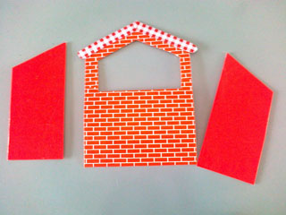
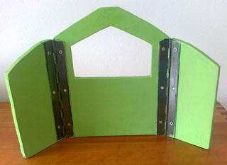
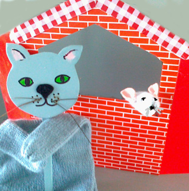

Spelletje:
 Hoe de kinderen het muisje redden.

Er was een mi-ma-muisje
 dat woonde in  een hi-ha-huisje
 En in dat huisje dideldond
 leefde zij blij en gezond.

Zeg, aardig mi-ma-muisje
 blijf jij maar in je hi-ha-huisje
 want om je huisje dideldond
 sluipt de pi-pa-poes in het rond.

O! Aardig mi-ma-muisje
 de pi-pa-poes kruipt IN je huisje!
 .......
 Maar uit het venster dideldond
 springt het muisje op de grond.
 Kom maar bij mij, mi-ma-muisje
 Verstop je maar gauw in mijn hi-ha-huisje.

Poppen: kat, muis (vingerpop)
 Klein poppenkastje.
 Opbouw:
 Regel 1 t/m 4: het versje opzeggen, muisje loopt in venster rond.
 Regel 5 t/m 8: De kat kijkt links en rechts achter de kast vandaan.
 Regel 9 en 10: De kat verdwijnt achter de kast.
 Regel 11 en 12: De redding van de muis gaat als volgt: de vingerpop wordt afgedaan en uit het venstertjegegooid. Voor de kast staat een kind te wachten, die de muis opvangt en beschermt door de handen als een holletje om de muis heen te doen. De kater komt scheldend uit het raam kijken en trekt zich daarna weer terug.

Bewerking van een spelletje uit: Puppenspiele aus aller Welt für die Jüngsten, door Inge Borde-Klein en Marga Arndt.

Druk het patroon van het poppenkastje af, zodat het het op een A4'tje past. Knip of snij de voorkant 1x en de zijkanten 2 keer uit stevig karton. Voor wie handig is met hout, kan het poppenkastje natuurlijk ook van triplex of multiplex worden gemaakt. Beplak alle delen met gekleurd papier (of beschilder het hout).

De "scharnieren"  kunnen van stevig plakband worden gemaakt (ook bij triplex), bij multiplex is het beter om een "echt" scharnier te kopen in de ijzerhandel.

De verbindingen maken via gaatjes en touwtjes kan ook.

De beschrijving van de handschoen-poes (boven) staat [hier](/handschoen). De vingerpop-muis is een "puntzakje" van stof, beschrijving [hier](/puntzakmuis).
 Het kan natuurlijk ook zo:
 De kat is hier een "lollie", een houten of kartonnen cirkel  op een stokje, met bijpassende handschoen.

