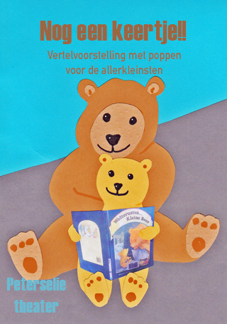
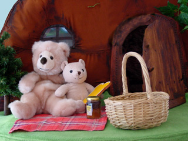
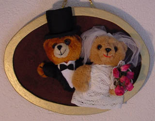

Dit intieme verhaaltje wordt op een decor-tafel gespeeld: het Kleine Beertje wordt door zijn Moeder voorgelezen en daarna gaan ze samen picknicken in de zon. Als het buiten koud en donker is, gaan ze naar binnen in het berenhol en dan wordt Beertje naar bed gebracht.
 Maar hij kan niet slapen omdat Mama Beer de rituelen-voor-het-slapen-gaan vergeet.

Ook beschikbaar als meedoe-voorstelling, waarbij de kinderen eerst vogeltjes maken, die later in de voorstelling mee doen. Voor meer info, zie [hier](/beertjemeedoe/).

Thema's: dieren, familie, voeding, voorlezen, slapen gaan, rituelen.
 Door de nadruk op mooi en duidelijk taalgebruik, gekoppeld aan het illustreren van de woorden met expressief poppenspel, is deze voorstelling uiterst geschikt bij het versterken van taalvaardigheid.
 We zingen bekende liedjes bij de trekharmonica. Voor wie vast wil oefenen is [hier](/files/liedjesbladnogeenkeertje.doc) een liedjesblad te downloaden. Het laden kan even duren.
 Klik [hier](/affichebeer/) voor een affiche.

Speladviezen: Willemijn Gadiot
 Bewegingsadviezen: Conny Oterdoom
 Ontwerp affiche: Marjanne Peters

leeftijd: vanaf 2 jaar
 geschikt voor mensen met een verstandelijke beperking
 duur: 30 tot 35 minuten
 opbouwen (met licht en geluid): 1,5 uur, afbreken 1 uur
 speelvlak: 3 x 3 meter
 oplopende zitplaatsen (zeker bij meer dan 40 kinderen!)
 niet te grote ruimte waar geen andere activiteit plaatsvindt, ook geen open bar
 €275,-, exclusief BTW en reiskosten  (€0.40/km)
 2e en volgende voorstellingen (op dezelfde plek, op dezelfde dag) €175,-
 Voor de prijs van een voorstelling voor particuliere partijtjes klik [hier](/feestjes/).

Ideale aantal kleuters: 40 (met eventueel 40 ouders).
 Eventueel kan na de voorstelling een workshop Berenmasker worden toegevoegd, tegen een meerprijs. Hiervoor zijn wel extra vrijwilligers nodig om te assisteren. Zie filmpje onderaan deze bladzijde.

Goed in te zetten voor Peutermarkten, Boekstart-activiteiten enz.
 De voorstelling kan worden aangepast aan de Sinterklaas- of Kersttijd, zonder dat het verhaal wezenlijk wordt veranderd.

Joke Kasemier-Bedeker (coordinator Boekstart) over deze voorstelling:
 De voorstelling “Nog een keertje” is volgens mij geschikt vanaf 1,5/ 2 jaar. Dit is de doelgroep van BoekStart in de kinderopvang. De allerjongste kinderen (baby-dreumes) hebben een korte spanningsboog, maar de voorstelling neemt hen mee in het verhaal door de afwisseling van poppenspel en kinderliedjes. Wel is belangrijk dat leidsters en ouders inschatten of het kind het nog leuk vindt en indien nodig afstand nemen met het kind.

Archief (dit gedeelte van de voorstelling (in het grote berenhol) wordt niet meer gespeeld):

 Archief: "Schilderijtje" uit het grote berenhol.

<iframe width="320" height="315" src="https://www.youtube.com/embed/ywn8b20GvYA" frameborder="0" allowfullscreen></iframe>

<iframe width="320" height="315" src="https://www.youtube.com/embed/fm8i4QYmBkA" frameborder="0" allow="autoplay; encrypted-media" allowfullscreen></iframe>

