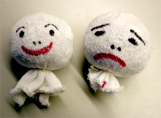
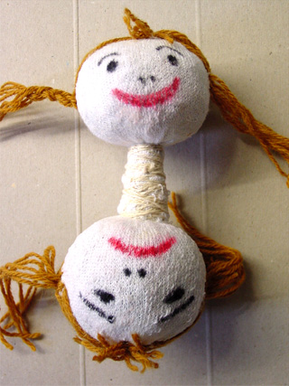
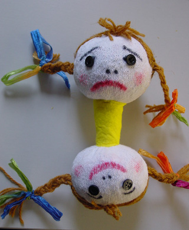

 Dit popje heeft een vrolijke en een minder vrolijke kant en kan dus emoties duidelijk maken.

 De afgeknipte tenen van oude sportsokken opvullen en dichtbinden. Teken (of plak) er een vrolijk en een kwaad, of sjagrijnig, of verdrietig gezicht op.

 Plak er een houtje tussen wat 2x zo lang is als een kop hoog. Steek het houtje met plaksel ongeveer tot halverwege de kop. Wind garen om het nekje en maak haren (wol, bont, boa enz.)

 Bedek het nekje met een stukje stof of vilt wat past bij de stof die je voor het jurkje gaat gebruiken, en naai vast.
 Voor het jurkje knip je een rechthoek van stof die ruim 4x zo breed is als je handbreedte. Naai tot een koker, rijg en rimpel de bovenkant en naai midden op het nekje rondom vast.

**ROODKAPJE OMDRAAIPOP** (archief)

 Dit is het enige attribuut dat Poppentheater Peterselie gebruikt bij het vertellen van het verhaal van Roodkapje.

 Allereerst de hoofdpersoon: Roodkapje.

 De wolf als de enge tegenspeler.

 Oma, het slachtoffer.

 En tenslotte de jager, die voor de (gebruikelijke) masculiene oplossing zorgt.

Peterselie vertelt het sprookje van Roodkapje met behulp van deze 4-in-1 pop, en daarna maakt iedereen in de workshop een omdraaipop, waar we ook een verhaaltje mee oefenen.

Je kunt de 4-in-1 Roodkapjepop natuurlijk gebruiken om Roodkapje op de normale manier te vertellen..... 
<iframe width="320" height="315" src="https://www.youtube.com/embed/-D-ARWhsDg4" frameborder="0" allowfullscreen></iframe>

....maar je kunt het ook een andere draai geven. 
<iframe width="320" height="315" src="https://www.youtube.com/embed/Z54M8nz_gYY" frameborder="0" allowfullscreen></iframe>

