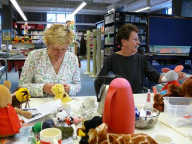

 
BESTAANDE KNUFFELS SPEELBAAR MAKEN 
Oftewel: Het opereren van beren, zoals deze workshop in de volksmond wordt genoemd. 
Bij deze workshop van een dagdeel wordt uitgegaan van bestaand speelgoed. 
Aan de hand van een tentoonstelling laat Peterselie zien wat er voor eenvoudige mogelijkheden zijn om een pop aan te passen.

Daarna gaan de cursisten zelf aan de slag. 
Er wordt een pop of knuffel meegenomen, die na wat "operaties" in te zetten is als theaterpop. 
De knuffels die soms bij prentenboeken verkrijgbaar zijn, zijn hier heel goed voor te gebruiken, maar ook bij een kringloopwinkel zijn voor een prikkie allerlei leuke dieren en poppen te koop. 
Bij het spelen voor kleine kinderen is het belangrijk, dat de figuren niet te cartoonachtig zijn.

Aan het eind worden eenvoudige oefeningen voor het bespelen van de poppen gedaan.

