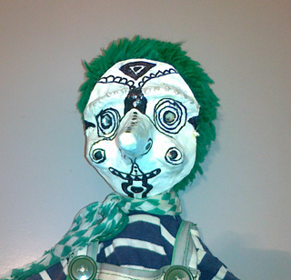
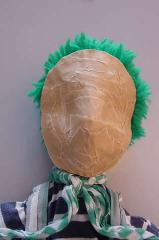
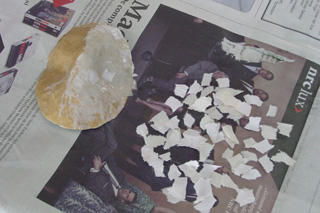
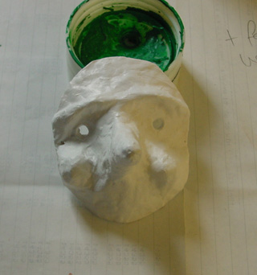

 Een masker dat precies op een gezicht past.

 Het slachtoffer bij binnenkomst.

 Haar dat in het gezicht valt, werken we weg met een haarband.

 Maak een stuk aluminiumfolie glad (op tafel leggen en er voorzichtig over wrijven) en leg het dubbel over het gezicht van de persoon waarvoor het  masker wordt.
 Druk de gelaatstrekken er voorzichtig in, eventuele vouwen die aan de rand ontstaan, vast zetten met plakband.
 Knip de randen een beetje in vorm. Leg het op  een halve bol van krantenproppen, tegen het indeuken.
 Smeer het aluminium in met lijm. Plak er stukjes papier op. Ik gebruik zelf altijd houtlijm; de meeste mensen gebruiken behangerslijm, dan heb je wat meer tijd om te werken.

 Kies voor de tweede laag een andere kleur papier.

 Breng neuzen, oogleden, dikke wangen, lippen e.d. aan met behangerstape en beplak het geheel weer met  stukjes papier.

 Laat het masker drogen en schilder het daarna.

Let op! Wil je dit masker echt gebruiken voor een voorstelling, zorg dan voor ademhalings- en ventilatie openingen. Er kan een spleet tussen de lippen worden uitgesneden en op andere strategische plekken kan verbandgaas over een uitgesneden gat worden geplakt en vervolgens mee-beschilderd met de rest.
