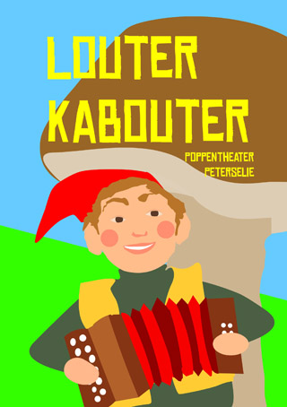

Helaas, deze voorstelling wordt niet meer door mij gespeeld: is verkocht aan een beginnend poppenspeelster!

Echte peutervoorstelling rondom kabouterliedjes- en spelletjes, geschikt voor kleine groepjes (tot 15 kinderen), met een paar enthousiasmerende volwassenen erbij.
 Om de sfeer echt peuter-achtig te houden is het belangrijk dat er geen oudere kinderen bij zijn.
 De liedjes worden begeleid op de trekharmonica.
 Kabouter Keesje Kervel zit verstopt in een rode doos met witte stippen en wat daar allemaal niet uitkomt als je wat verder zoekt!!!
[Hier](</files/Tips voor een kabouterfeestje encr.pdf>) kunnen de teksten van de gebruikte liedjes en tips voor de aankleding van het kabouterfeest worden gedownload (dit is natuurlijk geen must, maar wel leuk!).
 Klik [hier](/affichekabouter) voor een affiche.

Duur: ongeveer 30 minuten
 Prijs: 150 Euro (dit is bij een verjaardag thuis), 325 E ("gewone voorstelling")
 Aanwezig moeten zijn: voor ieder kind een PAPIEREN kaboutermuts, een kantoortafel en een rustige achtergrond zonder ramen.
 Opstelling: een half kringetje, met aan de open kant de tafel.

<iframe width="320" height="315" src="https://www.youtube.com/embed/CP_aZH3Kba8" frameborder="0" allowfullscreen></iframe>

