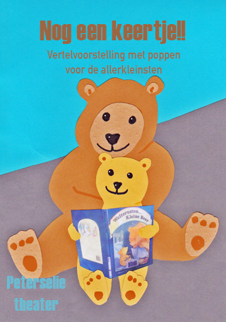
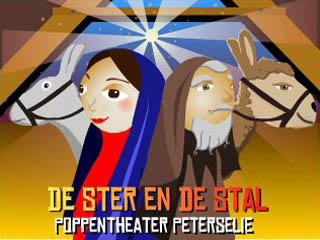
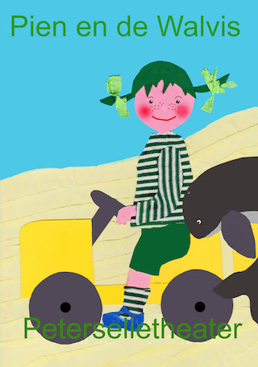
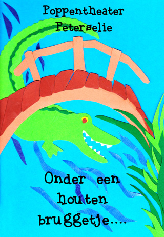
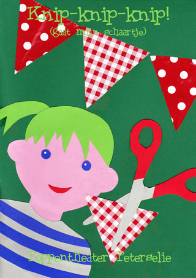
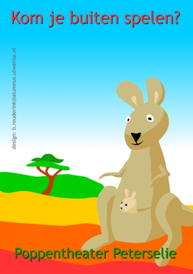
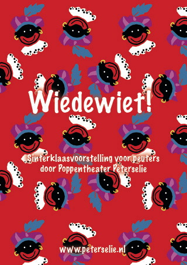
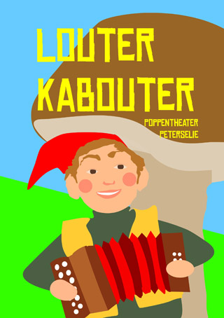
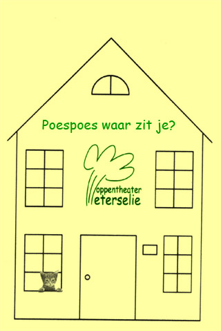

**ARCHIEF**
 Hieronder staan voorstellingen die u niet meer kunt boeken, maar het is misschien wel leuk om nog eens wat foto's of een filmpje te bekijken!

Poppentheater Peterselie heeft diverse voorstellingen voor erg jeugdig publiek.
 Bij het maken van deze voorstellingen is veel aandacht aan [taalbevordering](/taalbevordering) besteed.
 De onder- en bovenleeftijdsgrens dient wel heel erg goed in de gaten worden gehouden, want optreden voor een kleuter vereist een ander taalgebruik dan bij een peuter, en de spanningsboog verschilt nog al.

Door de simpele structuur, het eenvoudige taalgebruik en de interactie zijn deze voorstellingen uitermate geschikt voor mensen met een [beperking](/verstandelijkebeperking) en voor mensen die gebaat zijn bij prikkelvriendelijk aanbod.

Uit oogpunt van veiligheid is het noodzakelijk dat bij iedere voorstelling een eindverantwoorelijke persoon in de zaal aanwezig is.
 En....voor kleuters en zeker voor peuters is het prettig als er een bekende volwassene bij is!

Voor technische gegevens, klik [hier](/techniek).

[Nog een keertje:](/nogeenkeertje)[ ](/nogeenkeertje)

[Aangepaste versie van De Ster en de Stal:](/kerstvoorstelling)[ ](/kerstvoorstelling)

[Muis zoekt huis:](/muis)[ ](/muis)

[Alle eendjes:](/alleeendjes)[ ](/alleeendjes)

[Pien en de Walvis](/walvis)[ ](/walvis)

[De boerderij heeft er een geitje bij!](/geitje)[ ](/geitje)

[De boerderij heeft een dagje vrij!!](/boerderij)[ ](/boerderij)

[Onder een houten bruggetje](/knip)[ ](/bruggetje)

[Knip-knip-knip!](/knip)[ ](/knip)

[Kom je buiten spelen?:](/komjebuitenspelen)[ ](/komjebuitenspelen)

[Kleine Piet, wiedewiedewiet!](/sinterklaasvoorstelling)[ ](/sinterklaasvoorstelling)

[Louter Kabouter](/peuterfeestje)[ ](/peuterfeestje)

[Waar is mijn mama?](/waarismama)[ ](/mamakwijt)

[Ik kan toveren!](/toveren)[ ](/toveren)

[In de maneschijn](/indemaneschijn)[ ](/indemaneschijn)

[Zelluf doen!](/zellufdoen)[ ](/zellufdoen)

[Allerliefste billetjes](/allerliefstebilletjes)[ ](/allerliefstebilletjes)

[Poespoes waar zit je?](/poespoeswaarzitje)[ ](/poespoeswaarzitje) 
