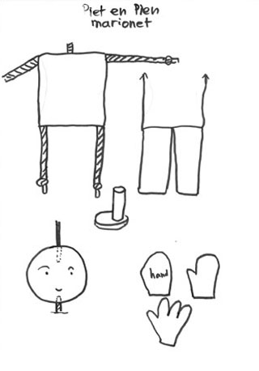
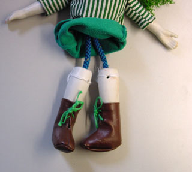

Deze eenvoudige marionetten bestaan eigenlijk uit een houten bal, een vierkant kussentje, met gekochte kussenvuling en wat kleine aquariumsteentjes (hangt lekker zwaar). De armen, benen en het nekje zijn van koord en worden aan het kussentje genaaid (zie plaatje). Bij gekochte handjes en voetjes het koord erin lijmen. Als de voetjes zelf worden gemaakt (rondje van triplex of dik karton met een stevig stokje erop gelijmd) kunnen er ook stroken leer of stevige stof worden gebruikt als benen. Dat kan gemakkelijk om het stokje van de voetjes (het onderbeen) worden geplakt. Daardoor blijven de tenen van de voetjes beter in de goede richting wijzen.
 Bij gebruik van triplex of vilt (dubbel) voor de handjes het koord een beetje platgedrukt vastplakken op het triplex of in het dubbele vilt.

 De handjes en voetjes van Pien komen van een tweedehands pop uit een kringloopwinkel.

Voor de hoofdjes: Gat boren aan de bovenkant voor de bedieningsstaaf. Aan de onderkant een gat boren om het nekkoord in te lijmen (gaatje iets kleiner boren dan de dikte van het koord).
 Hoofd kan natuurlijk ook van andere materialen zijn: piepschuim, een zelfgemaakte  bal van het opgevulde teenstuk van een sok enz.
 Als je ipv een kussentje als lijf een houten plankje neemt, kun je tussen het houten hoofd en het lijf ook 2 in elkaar gestoken schroefoogjes als nekje nemen.
 Neusje: op de houten kop een halve kraal lijmen.
 Plak er wiebeloogjes op, of maak oogjes van vilt.

Bij Piet bewegen de armen vanzelf door met de staaf bewegingen te maken (eenvoudige staaf rechts). Pien heeft een doorlopende draad aan beide armen bevestigd, die gaat door het krulletje van de staaf links op het plaatje. De staaf heb ik gemaakt van oud stevig electriciteitsdraad.
 Bij het gebruik van een eenvoudig kruis (zie [vogelmarionetten](http://www.peterselie.nl/vogelmarionetten)) heb je geen staaf in het hoofd nodig. De draden gaan van de oren naar A en B, de beide armen met een draad door het schroefoogje C) en een draad vanaf het midden van de achterkant van de kop naar het uiteinde zonder letter. De kop kan dan mooi allerlei bewegingen maken.
 En dan met wat fantasie nog aankleden!
