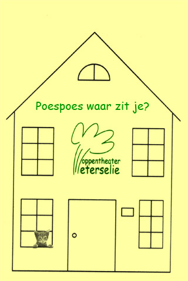
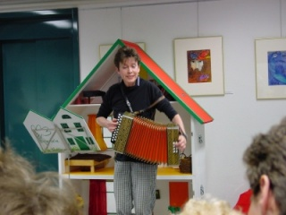

Deze voorstelling wordt niet meer gespeeld.

Inhoud: In een heel groot poppenhuis spelen Hond en Poespoes verstoppertje, maar Poespoes is te goed verstopt en Hond maakt er een verschrikkelijke rommel van...

 Bouw poppenhuis: Jan van Kammen

<iframe width="320" height="315" src="https://www.youtube.com/embed/HWoWbsDyXmM" frameborder="0" allowfullscreen></iframe>

