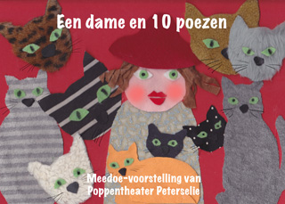

Workshop die bestaat uit het voordragen van het gedicht "Een dame en 10 poezen" door Peterselie, daarna het maken van poezen-poppen en tot slot het voor elkaar uitspelen van een gedicht met decorstukken die Peterselie heeft meegebracht. 
Kan toegevoegd worden aan de workshop Prent en Pop (volwassenen) of wat uitgebreider als zelfstandige workshop voor kinderen gebruikt worden (groep 3 en 4, met extra hulp ook voor groep 1 en 2). 
Aantal kinderen: 10-15 
Voor volwassenen is het maximum 30. 
Duur: 1,5 uur.

Steekwoorden: dieren, vriendschap, eenzaamheid 
Competenties: Het "levend" kunnen maken van een theaterpop en durven spelen 
Vakken: Nederlands, handvaardigheid, literatuur

 
De poezen achter het fornuis

 
Kinderen in bibliotheek Odoorn tijdens de Kinderboekenweek 2008

 
Ook geschikt voor volwassenen, als eind van een  workshop. Foto van Kinderopvangcongres De Reehorst, Ede 2008

 
In aangepaste vorm ook geschikt voor senioren, bijvoorbeeld in de dagopvang. Huize Odoorn, februari 2022
