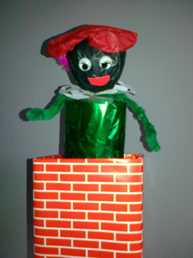
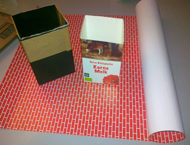

Piet kan ook een andere kleur gezicht hebben!

Nodig: 
leeg melkpak 
steentjespapier (per velletje 0.50 Euro bij hobbywinkel) 
sate-prikker 
prop papier voor hoofd 
zwart/bruin/roze/roetveeg crepe- of vloeipapier 
gekleurd papier voor beplakken van 
wc-rol 
klein rondje wit papier voor kraag 
rondje crepe- of vloeipapier voor pet 
veertje/rol-oogjes 
pijpenrager voor armen 
lijm/schaar/draad/plakband

Werkwijze: 
Knip bovenkant van melkpak af (bedenk dat je Pietje er helemaal in moet kunnen verdwijnen!) en beplak met steentjespapier. 
Knip een wc-rol doormidden en beplak 1 helft met gekleurd papier. 
Steek de sate-pen met lijm in de papierprop en bind dicht.

Vouw het vloeipapier strak om het hoofdje en bind het nekje dicht. 
Wikkel de pijpenrager er omheen en vouw de uiteinden tot handjes.

Maak een “kanten kleedje” van het rondje wit papier, maak er een knip in tot aan het midden en schuif om het nekje. 

 
Wijze van papier vouwen voor "kanten kleedje".

Pet: Maak van het rondje een zakje en bindt dicht. Sla plat en plak op het hoofdje. Veertje erop. Roloogjes op juiste plek. 
Plak het satestokje op de goede plek binnenin de wc-rol met plakband vast. Steek het stokje door de bodem van het melkpak. Klaar! 
Piet kan natuurlijk een pakje in zijn hand hebben of een piep-klein zakje of een roe van een paar takjes….
