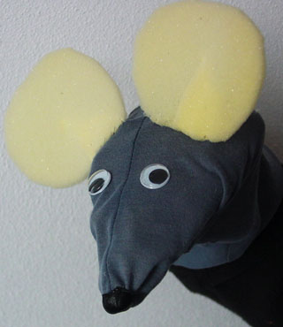

 Knip een driehoek van grijze stof.
 De driehoek voor de grote muis (zie foto onderaan) heeft 2 zijden van 35 cm en eentje van 30.
 De vingerpop heeft 2 zijden van 13 cm en eentje van 10 cm.

 Vouw het lapje stof dubbel met de verkeerde kant naar buiten.
 Naai met de hand of de naaimachine tot een puntzak (Of lijm het). Draai binnenste buiten, zodat de naad van binnen zit.

Plak of naai er oren, ogen, eventueel snorharen, en een neus op. En vergeet de staart niet!

 Met de duim kan een soort onderkaak in deze grote muizenkop worden geduwd, waardoor hij echt kan praten.
