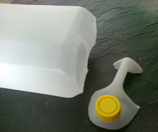
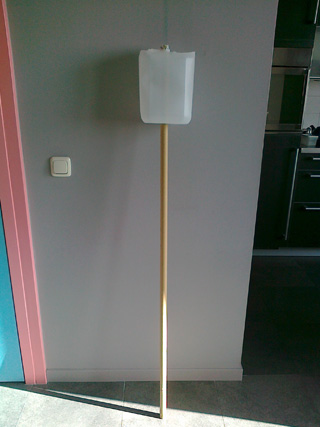
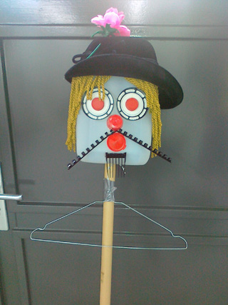

 Meer dan levensgrote stokpop (om bijvoorbeeld in een optocht mee te lopen, of als reus bij een stokpoppenspel).

Snij met een Stanleymes voorzichtig de overbodige delen van een plastic-5 liter container.

Maak in het midden van de boven-en onderkant een kruisvormige inkeping en steek een bezemsteel  (of zoals hier een dunne kartonnen koker: lekker licht!) dwars door de container.

Laat de stok er een cm bovenuit steken (dat wordt wel onzichtbaar door het haar of de hoed) en maak met crepetape de stok aan de container vast. Maak in eventueel storende punten een snee en plak de kanten van de snee over elkaar met tape, zodat het wat ronder wordt.

Versier de kop met allerlei hobbymateriaal (een lijmpistool is handig, maar tikje gevaarlijk) en bijvoorbeeld een pet, hoed, oorbellen of bril.
 Tape een ijzeren kleerhanger  aan de stok (eventueel de ronde haak er van te voren af knippen met een tang).
 Hang er daarna een grote vierkante lap of  echt kledingstuk over heen.
 Een rommelige hals bedekken met een sjaaltje.
 Een andere mogelijkheid is om  crepe-papier stroken aan de bovenkant van de kleerhanger (of een stok) te laten wapperen.
 Een spook krijg je met een laken  over het hoofd, de nek afbinden.

 Handvormen

Maak handen van karton  voor de pop en niet ze vast in de uiteinden van de lap of de mouwen, met de  duim naar boven wijzend. Aan de handen kunnen voerstokken van bijvoorbeeld bamboe worden bevestigd (splijt het uiteinde van de stok en lijm de hand in de spleet). Er kan maar één poppenhand tegelijk worden bediend, als de speler ook de stok vast heeft. De andere hand blijft gewoon bungelen.

Je kunt de 5-liter-container ook bedekken met  een panty of er stretchstof omheen spannen. Ogen, mond, neus enz. kunnen er dan opgenaaid of opgeplakt worden. De stof beschilderen kan ook.
 Of we kunnen de container bedekken met papieren snippers met behangerslijm en dit hard laten worden (niet meer dan 3 lagen tegelijk opbrengen). Gelaatstrekken (bijvoorbeeld van eierdozen) erop vast maken met crepetape en daarna weer  papiersnippers erover heen tot het een stevige en gladde “korst” is. Schilderen of andere hobbymaterialen gebruiken om het af te maken. Deze methode geeft een licht en stevig hoofd.

Als je aan een  ceintuur  een stevig zakje maakt, waar de stok in kan (zoiets als vaandeldragers gebruiken) en om je nek een (losse) band waar de stok in “hangt”, heb je beide handen vrij om de poppenarmen te bewegen. Soms zie je dan niets meer, omdat je verdwijnt in het poppenlijf. Maak dan kijkgaten in de kleding, bedekt met transparante stof.
