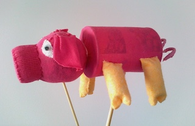

Deze techniek is de moeite waard, omdat die zo eenvoudig is:
 \- Bind de teen van een kindersok om een klein potje. Dit vormt de kop/het hoofd en het nekje. Let op: de hiel van de sok zit aan de kant van het achterhoofd.
 \- Stop dan een blik (bruine bonen of linzen of zo) in de sok met de open kant naar beneden.
 \- Stop de boord van de sok in de open kant. Dat blijft meestal vanzelf zitten. Anders even wat lijm aan de binnenkant van het blik.
 \- Versier met oogjes, oren, eventueel armen.
 De Varkens-stokpop is op dezelfde manier gemaakt, alleen met een zachte bal als kop.
 Het hoeft trouwens niet persé een dier te zijn, een mens kan natuurlijk ook.
 Als de sok erg licht en/of dun is, schijnt de tekst van het blik er soms doorheen. Dan even een kwa kleur bijpassend stuk papier om het blik plakken, of een stuk stof, of verven.

[Schaap.mov](https://peterselie.nl/files/Schaap.mov "Download: Schaap.mov (14.84 MB)")

