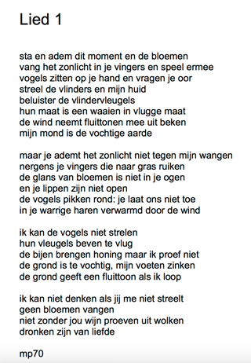

**Boek over #subpersoonlijkheden** 

 
Voor meer info, zie https://peterselie.nl/boekpoppenspel

**Artikelen**

[Vertellen met extra's_artikel.pdf](<https://peterselie.nl/files/Vertellen met extra's_artikel.pdf> "Download: Vertellen met extra&#039;s_artikel.pdf (96.89 KB)")

**Verhalen/gedichten van een tijd geleden** 
Klik eventueel op de plaatjes om te vergroten.

Klik op de poster voor het verhaal De Boodschapper, waar ooit nog eens een voorstelling van gaat komen. 

Klik op het plaatje voor de rest van het verhaal. 

De voorstelling "Van de Visser en zijn Hebberige Vrouw" is gebaseerd op een sprookje dat ik had herschreven voor een wedstrijd. [Klik hier voor het gepubliceerde verhaal.](/verhaalvisser) 

