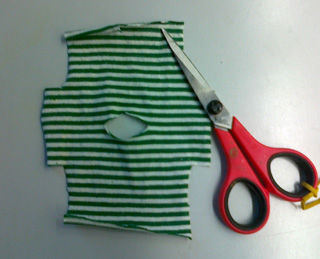
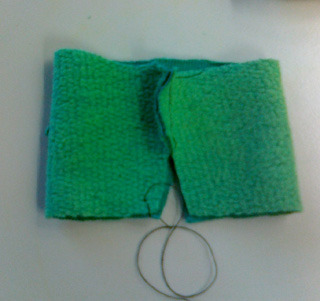
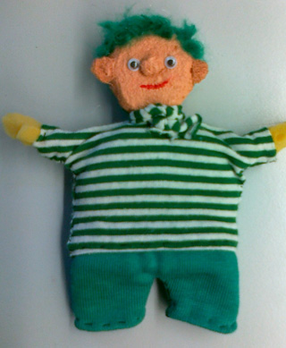
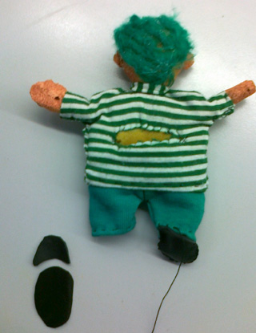

 Knip een hoofd en een lijf uit een schuursponsje (zonder het groene schuurlapje).

 Maak aan de rugkant  halverwege een inkeping met een Stanleymes (tot halverwege de dikte van de spons) en aan de onderzijde ook. Maak met 2 vingers een verbinding tussen deze twee inkepingen.

 Knip uit de restantjes van het schuursponsje de 2 armpjes.

 Met verf, roloogjes, draadjes wol (en eventueel andere hobby-materialen) wordt het hoofd gemaakt. De armpjes met een paar steken vastzetten.

 Knip uit een tricot lapje het truitje. Naai de zijkanten en de naad van de mouwtjes.

 Maak aan de achterkant een snee voor de vingers in het truitje en zet vast op de snede in het schuursponsje. Knip het broekje.

 Eerst de bovenste helft van de buitenkanten aan elkaar zetten (=de bilnaad). Dan de bilnaad in het midden leggen, zodat de pijpjes een beetje bijgeknipt kunnen worden. Naai nu de binnenkanten van de pijpjes.

 Zoom en zet met een paar steekjes vast aan het lijf, onder het shirt.

 Je kunt gewoon met je blote vingers gaan spelen, maar voor schoentjes knip je een zooltje en een bovenkantje uit vilt of leer. Klein beetje vulsel erin, als ze aan elkaar genaaid zijn, dan aan broekspijp zetten.
 Je kunt natuurlijk ook bijvoorbeeld kant-en-klare klompjes in de winkel kopen.

<iframe width="320" height="315" src="https://www.youtube.com/embed/pVUd3Ir4cYo" frameborder="0" allowfullscreen></iframe>

